# Sistema de Gestión de Servicios de Paisajismo, Mantenimiento de Jardines y Control Botánico

## Documentación técnica del proyecto final

**Autora:** Danna Paulina García Jiménez

**Docente:** Juan Carlos Gómez

**Asignatura:** Bases de Datos II

**Programa académico:** Ingeniería de Sistemas

**Universidad:** Universidad Católica Luis Amigó

**Fecha de entrega:** 13 de noviembre de 2026

> Proyecto final de Bases de Datos II. Solución full-stack construida con Flask, PyMongo y MongoDB Atlas, con interfaz web, API REST, reglas de negocio y cinco consultas analíticas mediante Aggregation Pipeline.

| Elemento de entrega | Enlace o referencia |
|---|---|
| Repositorio Git | `https://github.com/dannagarciaji-svg/Sistema_Paisajismo` |
| Aplicación desplegada | `[PENDIENTE: URL pública de Render]` |
| Documentación técnica | `docs/Documentacion_Tecnica_Sistema_Paisajismo.md` |
| Documento entregable | `docs/Documentacion_Tecnica_Sistema_Paisajismo.docx` |
| Evidencias gráficas | `docs/evidencias/` |
| Diagramas | `docs/diagramas/` |

**Resumen ejecutivo.** El presente documento describe el diseño, la implementación, las pruebas y el proceso de despliegue del Sistema de Gestión de Servicios de Paisajismo, Mantenimiento de Jardines y Control Botánico. La solución centraliza la operación de una empresa de jardinería en una base de datos documental alojada en MongoDB Atlas y la expone mediante una API REST modular en Flask. La interfaz web permite administrar clientes, propiedades con inventario botánico, contratos con servicios embebidos, personal técnico, visitas de mantenimiento e insumos, aplicando reglas de negocio e integridad referencial. Sobre esa información se ejecutan cinco consultas de agregación y un conjunto de indicadores que apoyan la planeación operativa y la toma de decisiones.

# Contenido

1. Descripción del problema y necesidad
2. Objetivo y alcance
3. Arquitectura implementada
4. Modelo de datos
5. Plataforma de base de datos en la nube
6. Conexión entre el backend y la base de datos
7. Funcionalidades desarrolladas
8. API REST
9. Reglas de negocio y validaciones
10. Consultas analíticas, reportes e indicadores
11. Pruebas y resultados
12. Evidencias
13. Despliegue
14. Conclusiones
15. Anexos

# 1. Descripción del problema y necesidad

## 1.1 Contexto

Las empresas dedicadas al paisajismo, la jardinería y el mantenimiento de zonas verdes coordinan a diario procesos administrativos y operativos que involucran información heterogénea: datos de contacto de clientes, características físicas de casas, fincas, oficinas, parques y conjuntos residenciales; inventario de especies vegetales con sus requerimientos botánicos; contratos con servicios y precios acordados; disponibilidad y especialidades del personal técnico; programación de visitas; y consumo real de fertilizantes, abonos, sustratos y productos fitosanitarios.

Cuando esta información se gestiona en hojas de cálculo aisladas, cuadernos de campo o mensajes dispersos, la empresa pierde una fuente única de verdad. Los datos se duplican, las visitas no se pueden auditar, el inventario se descontrola y resulta difícil responder preguntas básicas del negocio: qué cliente tiene más propiedades, qué servicios se contratan más, qué insumos se consumen más rápido, cuántas visitas están pendientes o qué trabajador está asignado a cada labor.

## 1.2 Problemática identificada

El diagnóstico del contexto permitió identificar los siguientes problemas:

- **Dispersión de la información:** los clientes, las propiedades y los contratos se registran en archivos separados que no se relacionan entre sí.
- **Pérdida de trazabilidad:** no existe un historial consolidado de las visitas realizadas por propiedad, con actividades, observaciones, personal e insumos.
- **Dificultad para consultar relaciones:** para saber qué propiedades pertenecen a un cliente o qué servicios incluye un contrato es necesario revisar manualmente varios archivos.
- **Descontrol del inventario:** el consumo de insumos no se descuenta de forma automática y no hay alertas tempranas de bajo stock o agotamiento.
- **Asignación empírica del personal:** no se verifica que el trabajador exista, esté activo, tenga la especialidad requerida o no esté repetido en la misma visita.
- **Programación inconsistente:** se agendan visitas sobre contratos vencidos, sobre propiedades de otro cliente o por fuera del período de vigencia del contrato.
- **Ausencia de métricas:** no se generan reportes sobre servicios más demandados, materiales más consumidos, cumplimiento de la agenda o distribución de visitas por estado.
- **Riesgo de exposición de credenciales:** las cadenas de conexión a la base de datos suelen quedar escritas en el código fuente o en repositorios públicos.

## 1.3 Formulación del problema

¿Cómo diseñar e implementar un sistema de información respaldado por una base de datos NoSQL alojada en la nube y una API modular que permita gestionar de forma centralizada clientes, propiedades, especies vegetales, contratos, personal, visitas de mantenimiento e insumos, integrando reglas de negocio y consultas analíticas para optimizar el control operativo de una empresa de paisajismo?

## 1.4 Justificación

El proyecto se justifica desde cuatro dimensiones:

- **Administrativa:** centraliza clientes, propiedades y contratos en una única fuente de verdad en la nube, eliminando la dependencia de archivos aislados y reduciendo duplicidades.
- **Operativa:** permite planificar visitas vinculadas a contratos y propiedades específicas, asignar personal, documentar actividades y observaciones de campo, y controlar el consumo de insumos con trazabilidad exacta.
- **Botánica:** incorpora dentro de cada propiedad el inventario de especies vegetales con nombre común, nombre científico, cantidad, ubicación y necesidades de cuidado, de modo que las intervenciones respeten los requerimientos de cada planta.
- **Académica y tecnológica:** materializa los conceptos de Bases de Datos II mediante modelado documental híbrido (Embedding y Referencing), alojamiento en la nube con MongoDB Atlas, seguridad de credenciales con variables de entorno, backend modular con Flask Blueprints y procesamiento analítico con Aggregation Pipelines.

# 2. Objetivo y alcance

## 2.1 Objetivo general

Desarrollar un sistema de información integral para la gestión de servicios de paisajismo, mantenimiento de jardines y control botánico, soportado por una base de datos documental en la nube (MongoDB Atlas) y un backend API modular en Python/Flask, que permita administrar las entidades del negocio, garantizar la integridad de los datos y generar consultas analíticas para la toma de decisiones.

## 2.2 Objetivos específicos

1. Identificar los requerimientos funcionales, no funcionales y reglas de negocio del dominio de paisajismo y mantenimiento de jardines.
2. Diseñar un modelo de datos documental en MongoDB compuesto por seis colecciones: `clientes`, `propiedades`, `servicios_contratos`, `personal`, `visitas_mantenimiento` e `insumos`, equilibrando estructuras embebidas (Embedding) y referenciadas (Referencing).
3. Configurar un clúster en la nube mediante MongoDB Atlas, con usuarios de base de datos, reglas de acceso de red y protección de la cadena de conexión mediante variables de entorno.
4. Desarrollar una API REST modular en Python/Flask con PyMongo y Blueprints, que ejecute operaciones CRUD completas sobre las seis colecciones.
5. Incorporar validaciones de tipos de datos, formatos de fecha ISO, existencia de referencias ObjectId y reglas de negocio para prevenir información incorrecta o inconsistente.
6. Construir y validar consultas analíticas avanzadas mediante Aggregation Pipeline (`$lookup`, `$match`, `$project`, `$sort`, `$limit`, `$group`, `$unwind`) para obtener reportes operativos y métricas del negocio.
7. Desarrollar la interfaz gráfica de usuario, ejecutar pruebas integrales de extremo a extremo y dejar la solución preparada para su despliegue y sustentación.

## 2.3 Alcance funcional

El sistema cubre los siguientes módulos:

- **Gestión de clientes:** registro, consulta general e individual, actualización y eliminación de personas o empresas contratantes, con validación de documento único.
- **Gestión de propiedades y control botánico:** administración de casas, fincas, apartamentos, oficinas, conjuntos residenciales y parques asociados a un cliente mediante `cliente_id`, incluyendo área en m², ubicación y arreglo embebido de especies vegetales con sus cuidados.
- **Gestión de servicios y contratos:** registro de contratos vinculados a clientes, fechas de vigencia, valor total calculado, estado y detalle embebido de los servicios contratados.
- **Gestión de personal:** administración de jardineros, paisajistas, especialistas botánicos, supervisores y auxiliares, con cargo, salario, estado y arreglo de especialidades.
- **Gestión de visitas de mantenimiento:** programación y seguimiento de visitas vinculadas a propiedades y contratos, asignación de personal, registro de actividades, observaciones e insumos consumidos.
- **Gestión de insumos:** control de inventario de fertilizantes, abonos, sustratos y productos fitosanitarios, con existencias, stock mínimo y estado derivado (`Disponible`, `Bajo stock`, `Agotado`).
- **Consultas analíticas y reportes:** ejecución de cinco pipelines de agregación que cruzan colecciones y consolidan métricas de operación.
- **Panel general:** indicadores de clientes, propiedades, área gestionada, contratos, cartera, visitas, cumplimiento, personal e insumos críticos.

## 2.4 Alcance tecnológico

La solución se estructura en tres capas:

1. **Capa de base de datos en la nube:** MongoDB Atlas, clúster `danna`, base de datos `jardineria_db`.
2. **Capa lógica o backend API:** Python 3.13, Flask 3.1.3, PyMongo 4.19.0, dnspython, python-dotenv y certifi; organización modular mediante Blueprints.
3. **Capa de presentación:** interfaz web en HTML5, CSS3 y JavaScript, con Chart.js para gráficos, conectada a los endpoints REST de Flask.

## 2.5 Limitaciones y elementos fuera del alcance inicial

En esta primera versión no se contemplan aplicaciones móviles nativas, geolocalización GPS en tiempo real, pasarelas de pago electrónico, facturación electrónica ante entidades tributarias, integración con sensores IoT de humedad o suelo, diagnóstico automático de plagas mediante visión artificial ni autenticación de usuarios finales. El acceso a la administración se controla en el entorno de despliegue, no mediante un módulo de login dentro de la aplicación.

# 3. Arquitectura implementada

## 3.1 Vista general

La aplicación implementa una arquitectura cliente-servidor de tres capas desacopladas:

- **Presentación:** una SPA (Single Page Application) construida con HTML5, CSS3 y JavaScript vanilla. Utiliza un enrutador por hash (`#/panel`, `#/clientes`, `#/propiedades`, `#/contratos`, `#/personal`, `#/visitas`, `#/insumos`, `#/analitica`) y consume la API mediante `fetch`. No requiere paso de compilación ni frameworks de frontend.
- **Lógica de negocio:** una API REST en Flask organizada por Blueprints. Cada entidad tiene su propio módulo de rutas; las validaciones y reglas transversales se concentran en `backend/validators.py`, `backend/utils.py` y `backend/inventario.py`. El punto de entrada `app.py` registra los Blueprints, sirve el frontend y centraliza el manejo de errores.
- **Datos:** MongoDB Atlas, base de datos documental `jardineria_db`, con seis colecciones e índices para los campos de búsqueda y relación más utilizados.

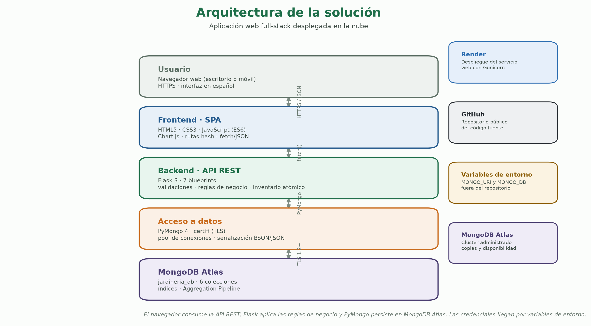

*Figura 1. Arquitectura de tres capas: SPA, API REST en Flask y MongoDB Atlas.*

## 3.2 Flujo de comunicación

El recorrido de una operación típica, por ejemplo registrar una visita de mantenimiento, es el siguiente:

1. La persona usuaria completa el formulario en la SPA y pulsa **Guardar**. El navegador construye un objeto JSON y ejecuta `fetch` contra el endpoint correspondiente, por ejemplo `POST /visitas_mantenimiento`.
2. Flask recibe la solicitud en el Blueprint `visitas_mantenimiento`. El controlador verifica que el cuerpo sea JSON, que los campos obligatorios estén presentes y que los identificadores tengan formato ObjectId válido.
3. El backend consulta las colecciones relacionadas para comprobar que la propiedad y el contrato existen, que pertenecen al mismo cliente, que el contrato está activo y que la fecha programada está dentro de su vigencia.
4. Se valida el personal asignado: debe existir, estar activo y no repetirse. Se validan los insumos: deben existir, no repetirse y tener existencias suficientes.
5. Si la visita consume insumos, `backend/inventario.py` descuenta las existencias de forma atómica con `find_one_and_update`. Si algo falla, se repone lo descontado.
6. PyMongo ejecuta la inserción en MongoDB Atlas. El backend responde con `201 Created`, el identificador generado y un mensaje de confirmación.
7. La SPA muestra una notificación, recarga la tabla y actualiza los indicadores del panel. Si la operación falla, muestra el mensaje de error devuelto por la API y no altera la información.

## 3.3 Organización del proyecto

```text
Sistema_Paisajismo/
├── app.py                         # Punto de entrada Flask y manejo global de errores
├── backend/
│   ├── config.py                  # Conexión única a MongoDB Atlas
│   ├── inventario.py              # Ajuste atómico de existencias
│   ├── utils.py                   # Serialización, ObjectId y errores API
│   ├── validators.py              # Validaciones y reglas compartidas
│   └── routes/
│       ├── clientes.py
│       ├── propiedades.py
│       ├── servicios_contratos.py
│       ├── personal.py
│       ├── visitas_mantenimiento.py
│       ├── insumos.py
│       └── analitica.py           # Cinco pipelines y KPIs
├── frontend/
│   ├── index.html
│   ├── css/estilos.css
│   └── js/
│       ├── api.js                 # Cliente HTTP y utilidades de formato
│       ├── formularios.js         # Formularios CRUD y subdocumentos
│       ├── vistas.js              # Vistas, tablas, modales y gráficos
│       └── app.js                 # Enrutador por hash y arranque
├── pruebas/
│   └── smoke_test.py              # 28 pruebas de integración
├── docs/
│   ├── diagramas/                 # Diagramas de arquitectura y modelo de datos
│   ├── evidencias/                # Capturas de pantalla
│   └── generar_diagramas.py       # Script reproducible de diagramas
├── seed.py                        # Datos de demostración e índices
├── requirements.txt
├── requirements-dev.txt
├── Procfile
├── render.yaml
├── .env.example
└── .gitignore
```

## 3.4 Tecnologías utilizadas

| Capa | Tecnología | Versión | Uso dentro del proyecto |
|---|---|---|---|
| Base de datos | MongoDB Atlas | Clúster M0 `danna` | Alojamiento en la nube de `jardineria_db` |
| Driver | PyMongo | 4.19.0 | Conexión, consultas, agregaciones e índices |
| Backend | Python | 3.13 | Lenguaje del servidor |
| Backend | Flask | 3.1.3 | API REST, Blueprints, servidor de archivos estáticos |
| Backend | python-dotenv | 1.2.4 | Carga de variables desde `.env` |
| Backend | dnspython | 2.9.2 | Resolución de cadenas `mongodb+srv://` |
| Seguridad TLS | certifi | 2026.10.23 | Autoridad certificadora para la conexión TLS |
| Producción | Gunicorn | 23.0.0 | Servidor WSGI para Render |
| Frontend | HTML5, CSS3, JavaScript | Estándares web | SPA responsive sin compilación |
| Gráficos | Chart.js | CDN | Visualización de reportes analíticos |
| Despliegue | Render | Servicio web gratuito | Publicación en internet |
| Control de versiones | Git y GitHub | — | Repositorio del código fuente |

## 3.5 Decisiones de arquitectura

- **Separación por capas:** el frontend no conoce la base de datos; solo consume JSON. Esto permite cambiar la interfaz o el motor de datos sin reescribir toda la solución.
- **Blueprints por entidad:** cada colección tiene un archivo independiente, lo que reduce el acoplamiento y facilita el mantenimiento. `app.py` solo registra los módulos y define el manejo global de errores.
- **Validación en el backend:** la flexibilidad de MongoDB no se delega al cliente. Toda regla crítica se verifica en el servidor, incluso si el frontend ya la valida.
- **Serialización centralizada:** `backend/utils.py` convierte ObjectId y fechas BSON a texto ISO 8601, de modo que las respuestas sean JSON válido y legibles.
- **Inventario atómico:** el descuento y la reposición se hacen con operaciones atómicas de MongoDB, no con lecturas y escrituras separadas, para evitar condiciones de carrera.
- **Credenciales fuera del código:** la cadena de conexión se lee de `MONGO_URI`; el archivo `.env` está excluido de Git y en producción se configura como variable de entorno.
- **Frontend sin compilación:** se eligió JavaScript vanilla para que el proyecto pueda ejecutarse y sustentarse sin depender de Node.js, npm o un proceso de build.

# 4. Modelo de datos

## 4.1 Diagrama del modelo

El modelo físico se compone de seis colecciones. Las relaciones principales se representan con referencias ObjectId y los datos que se consultan junto con su documento padre se almacenan como subdocumentos embebidos.

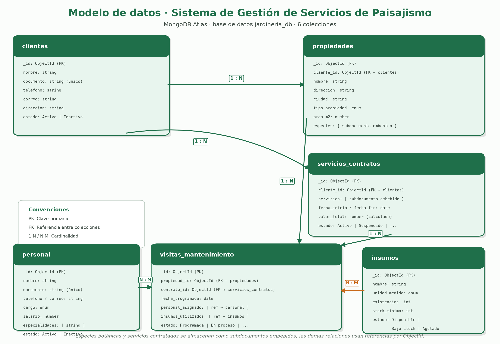

*Figura 2. Modelo de datos de `jardineria_db`: colecciones, campos principales, referencias y estructuras embebidas.*

## 4.2 Convenciones del modelo

- `_id` es un ObjectId generado por MongoDB y actúa como clave primaria.
- Los campos terminados en `_id` son referencias a otra colección.
- Las fechas se almacenan como `Date` de BSON y se serializan como ISO 8601 en las respuestas.
- Los estados y categorías usan enumeraciones cerradas definidas en `backend/validators.py`.
- Los nombres de campos, mensajes y datos de demostración están en español.
- Las listas embebidas (`especies`, `servicios`, `especialidades`, `personal_asignado`, `actividades_realizadas`, `observaciones`, `insumos_utilizados`) se validan como arreglos antes de persistir.

## 4.3 Colección `clientes`

Almacena personas naturales y empresas que contratan los servicios.

| Campo | Tipo | Obligatorio | Descripción | Ejemplo |
|---|---|---|---|---|
| `_id` | ObjectId | Sí | Clave primaria generada por MongoDB | `6af68888aa65f37681fe74ca` |
| `nombre` | String | Sí | Nombre de la persona o razón social | `Laura Martínez` |
| `documento` | String | Sí | Documento de identificación; único en la colección; 6 a 15 dígitos | `1020304050` |
| `telefono` | String | Sí | Teléfono de contacto; 7 a 20 caracteres válidos | `3001234567` |
| `correo` | String | Sí | Correo electrónico validado y almacenado en minúsculas | `laura.martinez@gmail.com` |
| `direccion` | String | Sí | Dirección de contacto | `Calle 20 #15-30` |
| `estado` | String | Sí | `Activo` o `Inactivo`; por defecto `Activo` | `Activo` |

## 4.4 Colección `propiedades`

Representa los predios gestionados y contiene el inventario botánico embebido.

| Campo | Tipo | Obligatorio | Descripción | Ejemplo |
|---|---|---|---|---|
| `_id` | ObjectId | Sí | Clave primaria | `6af68888aa65f37681fe74d1` |
| `cliente_id` | ObjectId | Sí | Referencia a `clientes._id` | `6af68888aa65f37681fe74ca` |
| `nombre` | String | Sí | Nombre del predio o zona verde | `Jardín Los Pinos` |
| `direccion` | String | Sí | Dirección del predio | `Carrera 45 #20-10` |
| `ciudad` | String | Sí | Ciudad o municipio | `Medellín` |
| `tipo_propiedad` | String | Sí | `Casa`, `Finca`, `Apartamento`, `Oficina`, `Conjunto residencial` o `Parque` | `Casa` |
| `area_m2` | Number | Sí | Área gestionada en metros cuadrados; mayor que cero | `150` |
| `especies` | Array<Object> | No | Inventario botánico embebido | Ver estructura siguiente |
| `especies[].nombre_comun` | String | Sí dentro del objeto | Nombre común de la especie | `Rosa` |
| `especies[].nombre_cientifico` | String | Sí dentro del objeto | Nombre científico | `Rosa spp.` |
| `especies[].cantidad` | Integer | Sí dentro del objeto | Cantidad de individuos; mayor que cero | `12` |
| `especies[].ubicacion` | String | No | Ubicación dentro del predio | `Jardín delantero` |
| `especies[].necesidades_cuidado` | String | No | Requerimientos de riego, poda, abono o luz | `Riego frecuente, poda y abono cada 30 días` |

## 4.5 Colección `servicios_contratos`

Registra los acuerdos comerciales y los servicios incluidos en cada uno.

| Campo | Tipo | Obligatorio | Descripción | Ejemplo |
|---|---|---|---|---|
| `_id` | ObjectId | Sí | Clave primaria | `6af68888aa65f37681fe74d9` |
| `cliente_id` | ObjectId | Sí | Referencia a `clientes._id` | `6af68888aa65f37681fe74ca` |
| `servicios` | Array<Object> | Sí | Servicios embebidos del contrato; al menos uno | Ver estructura siguiente |
| `servicios[].nombre` | String | Sí dentro del objeto | Nombre del servicio | `Mantenimiento de jardines` |
| `servicios[].descripcion` | String | No | Alcance del servicio | `Poda, riego y limpieza mensual` |
| `servicios[].precio_acordado` | Number | Sí dentro del objeto | Precio del servicio; mayor que cero | `650000` |
| `fecha_inicio` | Date | Sí | Inicio de vigencia | `2026-10-01T00:00:00Z` |
| `fecha_fin` | Date | Sí | Fin de vigencia; posterior a `fecha_inicio` | `2027-09-30T00:00:00Z` |
| `valor_total` | Number | Sí | Suma calculada de `precio_acordado` de los servicios | `1150000` |
| `estado` | String | Sí | `Activo`, `Suspendido`, `Finalizado` o `Vencido` | `Activo` |

## 4.6 Colección `personal`

Contiene el personal técnico y operativo de la empresa.

| Campo | Tipo | Obligatorio | Descripción | Ejemplo |
|---|---|---|---|---|
| `_id` | ObjectId | Sí | Clave primaria | `6af6888baa65f37681fe74e6` |
| `nombre` | String | Sí | Nombre completo | `Carlos Ramírez` |
| `documento` | String | Sí | Documento único; 6 a 15 dígitos | `1098765432` |
| `telefono` | String | Sí | Teléfono de contacto | `3104567890` |
| `correo` | String | Sí | Correo electrónico validado | `carlos.ramirez@paisajismo.com` |
| `cargo` | String | Sí | `Jardinero`, `Paisajista`, `Especialista botánico`, `Supervisor` o `Auxiliar de jardinería` | `Jardinero` |
| `salario` | Number | No | Salario mensual; mayor o igual a cero | `1800000` |
| `especialidades` | Array<String> | No | Especialidades técnicas del trabajador | `["Poda de plantas", "Control de plagas"]` |
| `estado` | String | Sí | `Activo` o `Inactivo`; por defecto `Activo` | `Activo` |

## 4.7 Colección `visitas_mantenimiento`

Es la entidad transaccional central. Relaciona una propiedad, un contrato, el personal asignado y los insumos consumidos.

| Campo | Tipo | Obligatorio | Descripción | Ejemplo |
|---|---|---|---|---|
| `_id` | ObjectId | Sí | Clave primaria | `6af6888eaa65f37681fe74fb` |
| `propiedad_id` | ObjectId | Sí | Referencia a `propiedades._id` | `6af68888aa65f37681fe74d1` |
| `contrato_id` | ObjectId | Sí | Referencia a `servicios_contratos._id` | `6af68888aa65f37681fe74d9` |
| `fecha_programada` | Date | Sí | Fecha y hora de la visita | `2026-11-05T08:00:00Z` |
| `personal_asignado` | Array<Object> | Sí | Al menos un trabajador; sin duplicados | Ver estructura siguiente |
| `personal_asignado[].personal_id` | ObjectId | Sí dentro del objeto | Referencia a `personal._id` | `6af6888baa65f37681fe74e6` |
| `personal_asignado[].nombre` | String | Sí dentro del objeto | Nombre desnormalizado para lectura | `Carlos Ramírez` |
| `actividades_realizadas` | Array<String> | No | Labores ejecutadas en la visita | `["Poda de rosales", "Corte de césped"]` |
| `observaciones` | Array<String> | No | Hallazgos y recomendaciones | `["Se recomienda reforzar el abono."]` |
| `estado` | String | Sí | `Programada`, `En proceso`, `Finalizada` o `Cancelada` | `Finalizada` |
| `insumos_utilizados` | Array<Object> | No | Insumos consumidos; solo en `En proceso` o `Finalizada` | Ver estructura siguiente |
| `insumos_utilizados[].insumo_id` | ObjectId | Sí dentro del objeto | Referencia a `insumos._id` | `6af6888caa65f37681fe74ef` |
| `insumos_utilizados[].nombre` | String | Sí dentro del objeto | Nombre desnormalizado del insumo | `Fertilizante NPK 10-30-10` |
| `insumos_utilizados[].cantidad` | Integer | Sí dentro del objeto | Cantidad consumida; entero mayor que cero | `3` |
| `insumos_utilizados[].unidad_medida` | String | Sí dentro del objeto | Unidad al momento del consumo | `Kilogramos` |

## 4.8 Colección `insumos`

Controla el inventario de materiales y productos.

| Campo | Tipo | Obligatorio | Descripción | Ejemplo |
|---|---|---|---|---|
| `_id` | ObjectId | Sí | Clave primaria | `6af6888caa65f37681fe74ef` |
| `nombre` | String | Sí | Nombre del insumo | `Fertilizante NPK 10-30-10` |
| `descripcion` | String | No | Descripción o uso | `Fertilizante granular completo para nutrición de plantas y césped` |
| `unidad_medida` | String | Sí | `Kilogramos`, `Litros`, `Unidades`, `Bultos`, `Metros` o `Mililitros` | `Kilogramos` |
| `existencias` | Integer | Sí | Unidades disponibles; entero mayor o igual a cero | `59` |
| `stock_minimo` | Integer | Sí | Umbral de reposición; entero mayor o igual a cero | `15` |
| `estado` | String | Sí | Derivado de existencias y stock mínimo: `Disponible`, `Bajo stock` o `Agotado` | `Disponible` |

## 4.9 Relaciones entre colecciones

| Colección origen | Colección destino | Cardinalidad | Campo de enlace | Tipo de relación |
|---|---|---|---|---|
| `clientes` | `propiedades` | 1 : N | `propiedades.cliente_id` | Referencia |
| `clientes` | `servicios_contratos` | 1 : N | `servicios_contratos.cliente_id` | Referencia |
| `propiedades` | `visitas_mantenimiento` | 1 : N | `visitas_mantenimiento.propiedad_id` | Referencia |
| `servicios_contratos` | `visitas_mantenimiento` | 1 : N | `visitas_mantenimiento.contrato_id` | Referencia |
| `personal` | `visitas_mantenimiento` | N : M | `visitas_mantenimiento.personal_asignado.personal_id` | Referencia en arreglo |
| `insumos` | `visitas_mantenimiento` | N : M | `visitas_mantenimiento.insumos_utilizados.insumo_id` | Referencia en arreglo |
| `propiedades` | `especies` | 1 : N | Subdocumentos en `propiedades.especies` | Embebido |
| `servicios_contratos` | `servicios` | 1 : N | Subdocumentos en `servicios_contratos.servicios` | Embebido |

## 4.10 Decisiones de diseño: Embedding y Referencing

Se aplicó un enfoque híbrido fundamentado en los patrones de acceso a los datos y en el ciclo de vida de cada entidad.

| Estructura | Estrategia | Justificación |
|---|---|---|
| Especies vegetales dentro de `propiedades` | Embedding | Las plantas pertenecen físicamente a un jardín y siempre se consultan junto con la propiedad. Embeberlas permite recuperar la ficha botánica completa en una sola lectura. |
| Servicios dentro de `servicios_contratos` | Embedding | Los servicios y precios acordados forman parte histórica de cada contrato. Si se cambian las tarifas generales, los acuerdos ya firmados no deben alterarse. |
| Especialidades dentro de `personal` | Embedding | Es una lista acotada de atributos propios del trabajador y se consulta con su ficha. |
| Actividades y observaciones dentro de `visitas_mantenimiento` | Embedding | Son listas acotadas de texto que describen la ejecución de una visita y no se consultan de forma independiente. |
| `cliente_id` en propiedades y contratos | Referencing | Un cliente puede tener muchas propiedades y contratos. Referenciar evita duplicar sus datos y permite actualizar el contacto en un solo lugar. |
| `propiedad_id` y `contrato_id` en visitas | Referencing | Las visitas crecen de forma ilimitada en el tiempo; embeber propiedades o contratos duplicaría información y dificultaría las consultas cruzadas. |
| `personal_id` e `insumo_id` en visitas | Referencing | Se necesita integridad con el catálogo de personal y de insumos, además de trazabilidad cruzada para las consultas analíticas. |
| `nombre` en `personal_asignado` y en `insumos_utilizados` | Desnormalización controlada | Permite mostrar información legible sin un `$lookup` adicional y conserva el nombre histórico al momento de la visita. La fuente de verdad sigue siendo la colección referenciada. |

El modelo evita los extremos: no embebe entidades maestras que se actualizan con frecuencia ni referencia datos que siempre se leen juntos. Las listas embebidas son acotadas por la operación del negocio (una propiedad tiene unas pocas especies, una visita tiene unos pocos trabajadores e insumos), por lo que no se acerca al límite de 16 MB por documento.

## 4.11 Índices

Los índices se crean de forma reproducible en `seed.py`. Además del índice automático sobre `_id`, se definieron los siguientes:

| Colección | Índice | Propósito |
|---|---|---|
| `clientes` | `documento` (único) | Garantizar unicidad y acelerar búsquedas por documento |
| `clientes` | `nombre` | Ordenar y buscar por nombre |
| `clientes` | `estado` | Filtrar clientes activos o inactivos |
| `propiedades` | `cliente_id` | Resolver la relación con clientes y las consultas por cliente |
| `propiedades` | `ciudad` | Filtrar por ciudad |
| `propiedades` | `nombre` | Ordenar y buscar por nombre |
| `servicios_contratos` | `cliente_id` | Consultar contratos de un cliente |
| `servicios_contratos` | `estado` | Filtrar contratos activos, suspendidos, finalizados o vencidos |
| `servicios_contratos` | `fecha_inicio` | Ordenar y consultar vigencias |
| `personal` | `documento` (único) | Garantizar unicidad y acelerar búsquedas |
| `personal` | `cargo` | Filtrar por cargo |
| `visitas_mantenimiento` | `propiedad_id` | Historial de visitas por propiedad |
| `visitas_mantenimiento` | `contrato_id` | Visitas asociadas a un contrato |
| `visitas_mantenimiento` | `estado` | Filtrar por estado operativo |
| `visitas_mantenimiento` | `fecha_programada` | Ordenar y filtrar por rango de fechas |
| `visitas_mantenimiento` | `personal_asignado.personal_id` | Consultar visitas de un trabajador |
| `visitas_mantenimiento` | `insumos_utilizados.insumo_id` | Consultar consumos de un insumo |
| `insumos` | `nombre` | Ordenar y buscar por nombre |
| `insumos` | `estado` | Filtrar por disponibilidad |

## 4.12 Integridad sin claves foráneas automáticas

MongoDB no impone claves foráneas. Por eso el backend implementa controles explícitos antes de cada escritura:

- Validación del formato ObjectId con `ObjectId.is_valid`.
- Verificación de existencia del documento referenciado.
- Verificación de reglas de negocio entre documentos (mismo cliente, contrato activo, fecha dentro de vigencia).
- Bloqueo de eliminación cuando existen documentos dependientes.
- Ajuste atómico de inventario con reposición compensatoria si falla la operación principal.

Estas comprobaciones se ejecutan en el servidor y no dependen de que el frontend las realice.

# 5. Plataforma de base de datos en la nube

## 5.1 Plataforma seleccionada

Se seleccionó **MongoDB Atlas** como plataforma de base de datos en la nube. La base de datos se denomina `jardineria_db` y reside en el clúster `danna`. La conexión se realiza mediante una cadena `mongodb+srv://` con TLS, usando un usuario de base de datos dedicado y una lista de acceso de red configurada en Atlas.

## 5.2 Uso dentro del proyecto

MongoDB Atlas cumple tres funciones:

1. **Almacenamiento persistente:** conserva las seis colecciones y los índices del sistema.
2. **Motor de consultas y agregaciones:** ejecuta los filtros, las búsquedas y los cinco pipelines analíticos directamente en el clúster.
3. **Servicio administrado en la nube:** permite que la aplicación desplegada en Render acceda a la información desde internet sin administrar servidores de base de datos.

## 5.3 Justificación de la elección

- **Modelo documental flexible (BSON/JSON):** se adapta naturalmente al negocio, permitiendo embeber listas variables de especies dentro de cada propiedad o servicios dentro de cada contrato sin tablas intermedias innecesarias.
- **Potencia analítica nativa:** el Aggregation Framework permite cruzar colecciones con `$lookup`, descomponer arreglos con `$unwind` y agrupar con `$group` sin exportar los datos a otra herramienta.
- **Integración con Python:** el driver oficial PyMongo manipula documentos BSON, ObjectId e ISODate de forma directa.
- **Disponibilidad y seguridad:** el clúster administrado ofrece cifrado TLS, copias de seguridad, monitoreo y control de acceso por usuario y por rango de IP.
- **Costo adecuado para el proyecto:** el nivel gratuito M0 es suficiente para la sustentación y permite escalar a un nivel superior si la operación crece.
- **Trazabilidad y evidencias:** la interfaz de Atlas permite inspeccionar colecciones, documentos, índices y resultados de agregaciones, lo que facilita la sustentación técnica.

## 5.4 Seguridad y control de acceso

- La cadena de conexión se almacena en la variable de entorno `MONGO_URI`, nunca en el código fuente.
- El archivo `.env` está incluido en `.gitignore` y no se publica en el repositorio.
- En Atlas se utiliza un usuario de base de datos dedicado, con permisos sobre `jardineria_db`.
- La lista de acceso de red se configura con la IP del entorno de desarrollo y con el rango necesario para el despliegue. Para Render se recomienda habilitar el acceso desde `0.0.0.0/0` o desde los rangos de salida del servicio, según la documentación vigente de Render.
- La conexión usa TLS y `certifi` como autoridad certificadora.
- Las respuestas de error no exponen la cadena de conexión ni detalles internos del clúster.

## 5.5 Evidencias de la nube

Las capturas de la interfaz de MongoDB Atlas deben anexarse en `docs/evidencias/` con los siguientes nombres sugeridos:

- `12_atlas_colecciones.jpg`: clúster `danna` y base de datos `jardineria_db` con las seis colecciones.
- `13_atlas_documentos.jpg`: documentos de `propiedades` y `visitas_mantenimiento` con ObjectId y arreglos embebidos.
- `14_atlas_agregaciones.jpg`: ejecución de uno o más pipelines en la pestaña **Aggregations**.
- `15_atlas_indices.jpg`: índices creados sobre las colecciones.

Mientras esas capturas se anexan, la sección 12 incluye evidencia verificable de la conexión y de la información almacenada obtenida desde la propia API.

# 6. Conexión entre el backend y la base de datos

## 6.1 Variables de entorno

La aplicación utiliza dos variables:

| Variable | Descripción | Ejemplo |
|---|---|---|
| `MONGO_URI` | Cadena de conexión de MongoDB Atlas | `mongodb+srv://<usuario>:<contraseña>@<cluster>.mongodb.net/?retryWrites=true&w=majority` |
| `MONGO_DB` | Nombre de la base de datos | `jardineria_db` |

En desarrollo se cargan desde `.env`. En producción se configuran en el panel de Render. El archivo `.env.example` documenta las variables sin incluir credenciales reales.

## 6.2 Código de conexión

La conexión se centraliza en `backend/config.py` para evitar múltiples clientes y duplicación de configuración:

```python
import os

import certifi
from dotenv import load_dotenv
from pymongo import MongoClient

RAIZ_PROYECTO = os.path.dirname(os.path.dirname(os.path.abspath(__file__)))
load_dotenv(os.path.join(RAIZ_PROYECTO, ".env"))

MONGO_URI = os.getenv("MONGO_URI")
MONGO_DB = os.getenv("MONGO_DB", "jardineria_db")

if not MONGO_URI:
    raise RuntimeError(
        "No se encontró la variable MONGO_URI. "
        "Cree un archivo .env en la raíz del proyecto a partir de .env.example."
    )

client = MongoClient(
    MONGO_URI,
    tlsCAFile=certifi.where(),
    serverSelectionTimeoutMS=15000,
    appname="SistemaPaisajismo",
)

db = client[MONGO_DB]

clientes = db["clientes"]
propiedades = db["propiedades"]
servicios_contratos = db["servicios_contratos"]
personal = db["personal"]
visitas_mantenimiento = db["visitas_mantenimiento"]
insumos = db["insumos"]

COLECCIONES = {
    "clientes": clientes,
    "propiedades": propiedades,
    "servicios_contratos": servicios_contratos,
    "personal": personal,
    "visitas_mantenimiento": visitas_mantenimiento,
    "insumos": insumos,
}


def verificar_conexion():
    """Ejecuta un ping contra el clúster y devuelve True si responde."""
    try:
        client.admin.command("ping")
        return True
    except Exception:
        return False
```

El cliente se crea una sola vez y se reutiliza en todos los Blueprints (patrón Singleton). `serverSelectionTimeoutMS=15000` evita esperas indefinidas si el clúster no responde. `appname` identifica la aplicación en los registros de Atlas.

## 6.3 Verificación de la conexión

El endpoint `GET /api/health` ejecuta un `ping` y devuelve el estado de la conexión junto con el conteo de documentos por colección:

```json
{
  "estado": "ok",
  "base_de_datos": "jardineria_db",
  "colecciones": {
    "clientes": 8,
    "propiedades": 10,
    "servicios_contratos": 10,
    "personal": 9,
    "visitas_mantenimiento": 20,
    "insumos": 9
  }
}
```

Si el clúster no responde, el endpoint devuelve `503` con `estado: "degradado"`. Este endpoint se usa como **health check** en Render.

## 6.4 Manejo de errores de base de datos

`app.py` registra un manejador para `PyMongoError` que registra el detalle en el log del servidor y devuelve al cliente un mensaje genérico con código `503`:

```json
{
  "error": "No fue posible comunicarse con la base de datos en la nube."
}
```

También se manejan errores controlados de la API (`ErrorApi`) con códigos `400`, `404`, `409` y `503`, además de `404` para rutas inexistentes, `405` para métodos no permitidos y `500` para errores no controlados.

## 6.5 Protección de credenciales

- `.env` está en `.gitignore` junto con `.env.*`, excepto `.env.example`.
- El código nunca contiene la contraseña ni la cadena completa.
- En Render, `MONGO_URI` se define como variable secreta (`sync: false` en `render.yaml`).
- La documentación y los ejemplos usan marcadores `<usuario>` y `<contraseña>`.
- Si una credencial se expone accidentalmente, debe rotarse en Atlas y actualizarse en el entorno de despliegue.

# 7. Funcionalidades desarrolladas

## 7.1 Panel general

El panel presenta una lectura rápida de la operación:

- Clientes activos sobre el total.
- Número de propiedades y área total gestionada.
- Contratos activos y valor de la cartera contratada.
- Personal activo sobre el total.
- Total de visitas y tasa de cumplimiento (visitas finalizadas sobre el total).
- Distribución de visitas por estado.
- Próximas visitas de los siguientes siete días con propiedad, cliente, fecha, estado y personal asignado.
- Insumos críticos con existencias iguales o inferiores al stock mínimo.
- Insumo más consumido.
- Gráficos de distribución de visitas y de estado del inventario.

La información se obtiene de `GET /analitica/kpis`, que combina agregaciones y conteos sobre las seis colecciones.

## 7.2 Clientes

- Listado con nombre, documento, contacto, dirección y estado.
- Búsqueda por nombre, documento, correo o dirección.
- Filtro por estado (`Activo` o `Inactivo`).
- Creación, edición y eliminación con confirmación.
- Validación de documento único y de formato de correo, teléfono y documento.
- Bloqueo de eliminación si el cliente tiene propiedades o contratos asociados.

## 7.3 Propiedades y control botánico

- Listado con nombre, cliente, ciudad, tipo, área, número de especies y número de visitas.
- Búsqueda por nombre, dirección, ciudad, nombre común o nombre científico de una especie.
- Filtros por ciudad, tipo de propiedad y cliente.
- Formulario con especies embebidas: nombre común, nombre científico, cantidad, ubicación y necesidades de cuidado.
- Vista de detalle con la ficha botánica completa y el historial de visitas de la propiedad.
- Validación de cliente existente y de área mayor que cero.
- Bloqueo de eliminación si la propiedad tiene visitas asociadas.

## 7.4 Servicios y contratos

- Listado con cliente, servicios, vigencia, valor total y estado.
- Búsqueda por nombre o descripción del servicio.
- Filtros por estado, cliente y vigencia (`vigente=true`).
- Formulario con servicios embebidos y cálculo automático del valor total.
- Vista de detalle con la lista completa de servicios y precios.
- Validación de cliente existente, al menos un servicio, fechas coherentes y valor total igual a la suma de los precios.
- Bloqueo de eliminación si el contrato tiene visitas asociadas.

## 7.5 Personal

- Listado con nombre, documento, contacto, cargo, especialidades, salario y estado.
- Búsqueda por nombre, documento, correo o especialidad.
- Filtros por cargo, estado y especialidad.
- Formulario con especialidades como lista.
- Validación de documento único, correo, teléfono, cargo y salario no negativo.
- Bloqueo de eliminación si el trabajador está asignado a visitas.

## 7.6 Visitas de mantenimiento

- Listado con fecha, propiedad, cliente, contrato, personal, número de insumos y estado.
- Búsqueda en actividades y observaciones.
- Filtros por estado y rango de fechas (`desde`, `hasta`).
- Formulario con selección de propiedad, contrato, personal e insumos.
- Vista de detalle con personal, servicios del contrato, insumos, actividades y observaciones.
- Validación de propiedad y contrato existentes, mismo cliente, contrato activo y fecha dentro de la vigencia.
- Validación de personal activo y sin duplicados.
- Control automático de inventario: descuento al registrar o actualizar consumos, reposición al eliminar la visita o reducir cantidades.
- Bloqueo de consumo en visitas `Programada` o `Cancelada`.

## 7.7 Insumos

- Listado con nombre, descripción, unidad, existencias, stock mínimo y estado.
- Búsqueda por nombre o descripción.
- Filtros por estado y por stock crítico (`bajo_stock=true`).
- Formulario de creación y edición.
- Estado calculado automáticamente: `Agotado` si las existencias son cero, `Bajo stock` si son menores o iguales al mínimo, `Disponible` en caso contrario.
- Bloqueo de eliminación si el insumo registra consumos en visitas.

## 7.8 Analítica y reportes

La vista de analítica presenta cinco reportes con tablas y gráficos:

1. Clientes y sus propiedades, con total de propiedades, área y especies.
2. Visitas con detalle completo de propiedad, cliente, contrato, personal e insumos.
3. Distribución de visitas por estado, con conteo y porcentaje.
4. Ranking de insumos más utilizados, con cantidad total, número de visitas y estado actual del inventario.
5. Servicios más contratados, con frecuencia, valor acumulado y precio promedio.

Los gráficos se construyen con Chart.js: barras para área por cliente, doughnut para estados de visita, barras para consumo de insumos y barras para servicios contratados.

## 7.9 Búsqueda y filtros

| Módulo | Búsqueda de texto | Filtros específicos |
|---|---|---|
| Clientes | Nombre, documento, correo, dirección | `estado` |
| Propiedades | Nombre, dirección, ciudad, especies | `ciudad`, `tipo_propiedad`, `cliente_id` |
| Contratos | Nombre y descripción del servicio | `estado`, `cliente_id`, `vigente` |
| Personal | Nombre, documento, correo, especialidades | `cargo`, `estado`, `especialidad` |
| Visitas | Actividades y observaciones | `estado`, `desde`, `hasta`, `propiedad_id`, `contrato_id`, `personal_id` |
| Insumos | Nombre y descripción | `estado`, `bajo_stock` |

## 7.10 Relaciones legibles

Las tablas y los formularios muestran nombres en lugar de ObjectId. Esto se logra con `$lookup` y `$unwind` en las consultas de listado:

- Las propiedades muestran el nombre y documento del cliente.
- Los contratos muestran el nombre del cliente.
- Las visitas muestran propiedad, ciudad, cliente, estado del contrato, servicios contratados, nombres del personal y nombres de los insumos.
- El detalle de una propiedad muestra su historial de visitas con el estado del contrato y los servicios asociados.

Además, las visitas guardan el nombre del trabajador y del insumo dentro de los arreglos embebidos, de modo que la información sea legible incluso si se consulta el documento directamente en Atlas.

## 7.11 Experiencia de usuario

- Interfaz en español, con navegación lateral y diseño responsive.
- Notificaciones tipo toast para confirmar operaciones y mostrar errores.
- Diálogos de confirmación antes de eliminar.
- Estados vacíos y mensajes de error amigables.
- Formularios con campos obligatorios, listas desplegables para enumeraciones y validación previa en el navegador.
- Botón de actualización de datos y verificación visible del estado de la base de datos.
- Formato de moneda colombiana y de fechas en la interfaz.

## 7.12 Control automático de inventario

El inventario es uno de los procesos con mayor riesgo de inconsistencia. La solución implementa el siguiente flujo:

1. Al crear o editar una visita, el backend normaliza los insumos y calcula la diferencia entre la cantidad nueva y la consumida previamente.
2. Para cada incremento de consumo, ejecuta `find_one_and_update` con el filtro `existencias >= cantidad`. La operación es atómica: si no hay existencias suficientes, no se descuenta nada y se devuelve `409`.
3. Si la visita se actualiza y se reduce la cantidad de un insumo, la diferencia se repone.
4. Si la visita se elimina, se reponen todos los insumos consumidos.
5. Si ocurre un error después de aplicar algunos descuentos, el bloque `except` repone los ajustes ya realizados antes de propagar el error.
6. El estado del insumo se recalcula en la misma operación atómica con un `$switch`: `Agotado` si las existencias llegan a cero, `Bajo stock` si son menores o iguales al mínimo, `Disponible` en caso contrario.

Este diseño evita el clásico problema de leer existencias, restar en memoria y escribir un valor desactualizado.

# 8. API REST

## 8.1 Convenciones

- Las rutas de la API están en la raíz del servidor (`/clientes`, `/propiedades`, etc.).
- Las solicitudes y respuestas usan JSON con codificación UTF-8.
- Los listados devuelven `{"datos": [...], "total": n}`.
- Las creaciones devuelven `201 Created` con `{"mensaje": "...", "id": "<ObjectId>"}`.
- Las actualizaciones y eliminaciones devuelven `200 OK` con un mensaje.
- Los errores devuelven `{"error": "...", "detalles": [...]}` cuando hay información adicional.
- Los identificadores se envían como texto y se validan como ObjectId.

## 8.2 Endpoints

| Método | Ruta | Descripción |
|---|---|---|
| GET | `/api/health` | Estado de la conexión y conteo por colección |
| GET | `/clientes` | Listar clientes con búsqueda y filtro por estado |
| GET | `/clientes/<id>` | Consultar un cliente |
| POST | `/clientes` | Crear un cliente |
| PUT | `/clientes/<id>` | Actualizar un cliente de forma parcial |
| DELETE | `/clientes/<id>` | Eliminar un cliente si no tiene dependencias |
| GET | `/propiedades` | Listar propiedades con cliente, especies y visitas |
| GET | `/propiedades/<id>` | Consultar una propiedad |
| GET | `/propiedades/<id>/historial` | Historial de visitas de la propiedad |
| POST | `/propiedades` | Crear una propiedad con especies embebidas |
| PUT | `/propiedades/<id>` | Actualizar una propiedad |
| DELETE | `/propiedades/<id>` | Eliminar una propiedad si no tiene visitas |
| GET | `/servicios_contratos` | Listar contratos con cliente y total de servicios |
| GET | `/servicios_contratos/<id>` | Consultar un contrato |
| POST | `/servicios_contratos` | Crear un contrato con servicios embebidos |
| PUT | `/servicios_contratos/<id>` | Actualizar un contrato |
| DELETE | `/servicios_contratos/<id>` | Eliminar un contrato si no tiene visitas |
| GET | `/personal` | Listar trabajadores con búsqueda y filtros |
| GET | `/personal/<id>` | Consultar un trabajador |
| POST | `/personal` | Crear un trabajador |
| PUT | `/personal/<id>` | Actualizar un trabajador |
| DELETE | `/personal/<id>` | Eliminar un trabajador si no está asignado |
| GET | `/visitas_mantenimiento` | Listar visitas con relaciones legibles y filtros |
| GET | `/visitas_mantenimiento/<id>` | Consultar una visita |
| POST | `/visitas_mantenimiento` | Crear una visita y descontar inventario |
| PUT | `/visitas_mantenimiento/<id>` | Actualizar una visita y ajustar inventario |
| DELETE | `/visitas_mantenimiento/<id>` | Eliminar una visita y reponer inventario |
| GET | `/insumos` | Listar insumos con filtros de stock |
| GET | `/insumos/<id>` | Consultar un insumo |
| POST | `/insumos` | Crear un insumo |
| PUT | `/insumos/<id>` | Actualizar un insumo y recalcular estado |
| DELETE | `/insumos/<id>` | Eliminar un insumo si no tiene consumos |
| GET | `/analitica/clientes-propiedades` | Reporte 1 |
| GET | `/analitica/visitas-detalle` | Reporte 2 |
| GET | `/analitica/visitas-estado` | Reporte 3 |
| GET | `/analitica/insumos-mas-utilizados` | Reporte 4 |
| GET | `/analitica/servicios-mas-contratados` | Reporte 5 |
| GET | `/analitica/kpis` | Indicadores del panel general |

## 8.3 Ejemplos de solicitud y respuesta

**Crear un cliente**

```http
POST /clientes
Content-Type: application/json

{
  "nombre": "Cliente de Ejemplo",
  "documento": "1099000111",
  "telefono": "3001112233",
  "correo": "cliente.ejemplo@correo.com",
  "direccion": "Calle 10 #20-30",
  "estado": "Activo"
}
```

Respuesta `201 Created`:

```json
{
  "mensaje": "Cliente registrado correctamente.",
  "id": "6af68901aa65f37681fe7501"
}
```

**Listar visitas con filtros**

```http
GET /visitas_mantenimiento?estado=Programada&desde=2026-11-01&hasta=2026-11-30
```

Respuesta `200 OK` (fragmento):

```json
{
  "datos": [
    {
      "_id": "6af6888eaa65f37681fe74fc",
      "fecha_programada": "2026-11-14T08:30:00Z",
      "estado": "Programada",
      "propiedad_nombre": "Finca El Paraíso",
      "propiedad_ciudad": "Envigado",
      "cliente_nombre": "Carlos Gómez",
      "contrato_estado": "Activo",
      "servicios_contratados": ["Diseño paisajístico", "Poda de altura"],
      "personal_asignado": [
        { "personal_id": "6af6888baa65f37681fe74e7", "nombre": "Lucía Pérez" }
      ],
      "total_personal": 1,
      "total_insumos": 0
    }
  ],
  "total": 1
}
```

**Error de regla de negocio**

```json
{
  "error": "No hay existencias suficientes del insumo seleccionado para cubrir el consumo."
}
```

## 8.4 Códigos HTTP utilizados

| Código | Significado | Ejemplo en el sistema |
|---|---|---|
| 200 | OK | Consulta o actualización exitosa |
| 201 | Created | Cliente, propiedad, contrato, visita o insumo creado |
| 400 | Bad Request | Campo obligatorio ausente, fecha inválida, ObjectId mal formado, regla de negocio incumplida |
| 404 | Not Found | Documento o ruta inexistente |
| 405 | Method Not Allowed | Método HTTP no permitido para la ruta |
| 409 | Conflict | Documento duplicado, stock insuficiente o eliminación con dependencias |
| 500 | Internal Server Error | Error no controlado |
| 503 | Service Unavailable | Fallo de conexión con MongoDB Atlas |

## 8.5 Filtros disponibles

- `GET /clientes?q=texto&estado=Activo`
- `GET /propiedades?q=Rosa&ciudad=Medellín&tipo_propiedad=Casa&cliente_id=<id>`
- `GET /servicios_contratos?estado=Activo&vigente=true&cliente_id=<id>`
- `GET /personal?cargo=Jardinero&especialidad=riego&estado=Activo`
- `GET /visitas_mantenimiento?estado=Programada&desde=2026-11-01&hasta=2026-11-30&personal_id=<id>`
- `GET /insumos?bajo_stock=true&estado=Bajo stock`
- `GET /analitica/visitas-detalle?estado=Finalizada`
- `GET /analitica/insumos-mas-utilizados?limite=5`

## 8.6 Seguridad de la API

- No se exponen credenciales en las respuestas.
- Los errores de MongoDB se registran en el servidor y se devuelven con un mensaje genérico.
- Se agregan cabeceras `X-Content-Type-Options: nosniff`, `X-Frame-Options: SAMEORIGIN` y `Referrer-Policy: strict-origin-when-cross-origin`.
- Los identificadores se validan antes de consultar la base de datos.
- Las expresiones regulares de búsqueda se escapan con `re.escape` para evitar inyección de patrones.
- El frontend escapa el texto antes de insertarlo en el DOM.

# 9. Reglas de negocio y validaciones

## 9.1 Enfoque

Las reglas se implementan en tres niveles:

1. **Frontend:** campos obligatorios, tipos de entrada, listas desplegables y mensajes inmediatos.
2. **Backend:** validación definitiva de tipos, formatos, referencias y reglas del dominio.
3. **Base de datos:** índices únicos y operaciones atómicas como última barrera de protección.

El backend es la autoridad. Aunque se omita la validación del navegador, la API rechaza la operación si incumple una regla.

## 9.2 Tabla de reglas y validaciones

| Código | Regla | Implementación | Respuesta |
|---|---|---|---|
| RN-01 | El documento de un cliente es único | Consulta previa e índice único `uq_clientes_documento` | 409 |
| RN-02 | El documento de un trabajador es único | Consulta previa e índice único `uq_personal_documento` | 409 |
| RN-03 | El correo debe tener formato válido | Expresión regular `CORREO_RE` y almacenamiento en minúsculas | 400 |
| RN-04 | El teléfono debe tener formato válido | Expresión regular `TELEFONO_RE` | 400 |
| RN-05 | El documento debe tener entre 6 y 15 dígitos | Expresión regular `DOCUMENTO_RE` | 400 |
| RN-06 | Las fechas deben ser ISO 8601 | `datetime.fromisoformat` con soporte de `Z` y conversión a UTC | 400 |
| RN-07 | Los estados, tipos, cargos y unidades deben pertenecer a enumeraciones cerradas | Función `enumeracion` y listas constantes | 400 |
| RN-08 | Los ObjectId deben tener formato válido | `ObjectId.is_valid` en `convertir_object_id` | 400 |
| RN-09 | Una propiedad debe pertenecer a un cliente existente | Consulta a `clientes` antes de guardar | 404 |
| RN-10 | Un contrato debe pertenecer a un cliente existente | Consulta a `clientes` antes de guardar | 404 |
| RN-11 | El área de una propiedad debe ser mayor que cero | `numero_positivo` | 400 |
| RN-12 | Un contrato debe tener al menos un servicio | Validación de lista no vacía | 400 |
| RN-13 | El valor total del contrato debe ser la suma de los precios de sus servicios | Cálculo en backend; rechazo si el valor enviado no coincide | 400 |
| RN-14 | La fecha de fin debe ser posterior a la fecha de inicio | `_validar_fechas` | 400 |
| RN-15 | Una visita debe referenciar una propiedad existente | Consulta a `propiedades` | 404 |
| RN-16 | Una visita debe referenciar un contrato existente | Consulta a `servicios_contratos` | 404 |
| RN-17 | La propiedad y el contrato de una visita deben pertenecer al mismo cliente | Comparación de `cliente_id` | 400 |
| RN-18 | Solo se programan visitas sobre contratos `Activo` | Verificación de `contrato.estado` | 400 |
| RN-19 | La fecha de la visita debe estar dentro de la vigencia del contrato | Comparación con `fecha_inicio` y `fecha_fin` | 400 |
| RN-20 | La visita debe tener al menos un trabajador asignado | Lista no vacía | 400 |
| RN-21 | El trabajador asignado debe existir y estar activo | Consulta a `personal` | 404 / 400 |
| RN-22 | Un trabajador no puede repetirse en la misma visita | Control de duplicados por ObjectId | 400 |
| RN-23 | Solo las visitas `En proceso` o `Finalizada` pueden consumir insumos | `_validar_estado_consumo` | 400 |
| RN-24 | Un insumo no puede repetirse en la misma visita | Control de duplicados por ObjectId | 400 |
| RN-25 | La cantidad de un insumo debe ser un entero mayor que cero | Validación de tipo y valor | 400 |
| RN-26 | El consumo no puede superar las existencias | Filtro atómico `existencias >= cantidad` | 409 |
| RN-27 | El estado del insumo se deriva de existencias y stock mínimo | `calcular_estado_insumo` y `$switch` atómico | Automático |
| RN-28 | No se elimina un cliente con propiedades o contratos | Conteo de dependencias | 409 |
| RN-29 | No se elimina una propiedad con visitas | Conteo de dependencias | 409 |
| RN-30 | No se elimina un contrato con visitas | Conteo de dependencias | 409 |
| RN-31 | No se elimina un trabajador asignado a visitas | Conteo de dependencias | 409 |
| RN-32 | No se elimina un insumo con consumos registrados | Conteo de dependencias | 409 |
| RN-33 | Al eliminar una visita se repone el inventario consumido | Reposición en `eliminar_visita` | Automático |
| RN-34 | Al reducir o eliminar consumos se repone la diferencia | `_aplicar_deltas_consumo` | Automático |
| RN-35 | Las actualizaciones parciales solo modifican los campos enviados | `PUT` con `$set` y validación parcial | 200 |
| RN-36 | Los campos obligatorios deben estar presentes en la creación | `validar_campos_requeridos` y validaciones por módulo | 400 |

## 9.3 Explicación de las reglas críticas

**Integridad referencial.** Antes de crear una propiedad, un contrato o una visita, el backend verifica que las referencias existan. No se permite guardar un `cliente_id`, `propiedad_id`, `contrato_id`, `personal_id` o `insumo_id` que no corresponda a un documento real. Esto sustituye las claves foráneas que MongoDB no impone por defecto.

**Coherencia entre propiedad, contrato y fecha.** Una visita no puede asociarse a una propiedad de un cliente y a un contrato de otro. Tampoco puede programarse sobre un contrato suspendido, finalizado o vencido, ni por fuera de las fechas de vigencia. La validación se ejecuta tanto en la creación como en la actualización, combinando los valores nuevos con los existentes cuando la actualización es parcial.

**Cálculo del valor del contrato.** El usuario no puede fijar arbitrariamente el `valor_total`. El backend suma los precios de los servicios embebidos y guarda ese resultado. Si el cliente envía un valor distinto, la operación se rechaza con un mensaje que indica el valor correcto. Esto evita inconsistencias entre el detalle y el total.

**Control de inventario.** El consumo solo se permite en visitas `En proceso` o `Finalizada`. El descuento se realiza con una operación atómica que incluye la condición de existencias suficientes. Si la visita se actualiza, se aplican deltas: lo que aumenta se descuenta y lo que disminuye se repone. Si la visita se elimina, se repone todo lo consumido. Si falla una parte de la operación, se compensan los ajustes ya aplicados.

**Eliminación protegida.** El sistema prefiere bloquear una eliminación antes que dejar datos huérfanos. Por eso un cliente con propiedades o contratos, una propiedad con visitas, un contrato con visitas, un trabajador asignado o un insumo con consumos no se pueden eliminar. El usuario debe eliminar o reasignar primero las dependencias.

**Actualizaciones parciales.** Los `PUT` permiten enviar solo los campos que cambian. El backend valida únicamente esos campos y conserva los demás. En visitas, si se cambia la propiedad, el contrato o la fecha, se vuelve a validar la coherencia con los valores combinados.

## 9.4 Validaciones en el frontend

- Campos obligatorios marcados y verificados antes de enviar.
- Listas desplegables para estados, tipos de propiedad, cargos, unidades y estados de visita.
- Validación de correo y teléfono con atributos HTML y expresiones regulares.
- Cálculo visible del valor total del contrato a partir de los servicios.
- Selección de personal e insumos desde catálogos reales, no mediante texto libre.
- Confirmación antes de eliminar.
- Mensajes de error provenientes del backend mostrados en un toast.

## 9.5 Consistencia y compensación

Las operaciones que afectan varias colecciones o varios documentos no usan transacciones multi-documento, porque el clúster gratuito y el alcance del proyecto no lo requieren. En su lugar se aplican estrategias de compensación:

- Validar todas las referencias antes de escribir.
- Descontar inventario antes de insertar la visita y reponer si la inserción falla.
- Registrar los ajustes aplicados y revertirlos en el bloque `except`.
- Bloquear eliminaciones con dependencias.

Este enfoque es suficiente para la operación del sistema y evita dejar datos parciales ante errores controlados.

# 10. Consultas analíticas, reportes e indicadores

## 10.1 Panorama de las cinco consultas

| # | Consulta | Colección base | Operadores principales | Utilidad |
|---|---|---|---|---|
| 1 | Clientes y sus propiedades | `clientes` | `$lookup`, `$addFields`, `$project`, `$sort` | Identificar clientes con más propiedades, área gestionada y especies |
| 2 | Visitas con detalle completo | `visitas_mantenimiento` | `$match`, `$lookup` ×3, `$unwind`, `$project`, `$sort` | Ver la ficha completa de cada visita sin ObjectId aislados |
| 3 | Distribución de visitas por estado | `visitas_mantenimiento` | `$facet`, `$group`, `$unwind`, `$project`, `$sort` | Medir carga pendiente frente a labores cumplidas |
| 4 | Insumos más utilizados | `visitas_mantenimiento` | `$unwind`, `$group`, `$addFields`, `$lookup`, `$project`, `$sort`, `$limit` | Planear compras y reposición de stock |
| 5 | Servicios más contratados | `servicios_contratos` | `$unwind`, `$group`, `$project`, `$sort` | Identificar las líneas de negocio de mayor demanda |

Todas las consultas se ejecutan en MongoDB Atlas mediante `collection.aggregate(pipeline)` y se serializan con `backend/utils.py`.

## 10.2 Consulta 1: clientes y sus propiedades registradas

**Pregunta de negocio:** ¿qué clientes tienen más propiedades, cuánta área gestionan y cuántas especies vegetales tienen registradas?

**Pipeline implementado:**

```python
pipeline = [
    {
        "$lookup": {
            "from": "propiedades",
            "localField": "_id",
            "foreignField": "cliente_id",
            "as": "propiedades",
        }
    },
    {
        "$addFields": {
            "total_propiedades": {"$size": "$propiedades"},
            "area_total_m2": {"$sum": "$propiedades.area_m2"},
            "total_especies": {
                "$sum": {
                    "$map": {
                        "input": "$propiedades",
                        "as": "propiedad",
                        "in": {"$size": {"$ifNull": ["$$propiedad.especies", []]}},
                    }
                }
            },
            "detalle_propiedades": {
                "$map": {
                    "input": "$propiedades",
                    "as": "propiedad",
                    "in": {
                        "nombre": "$$propiedad.nombre",
                        "ciudad": "$$propiedad.ciudad",
                        "tipo_propiedad": "$$propiedad.tipo_propiedad",
                        "area_m2": "$$propiedad.area_m2",
                        "total_especies": {
                            "$size": {"$ifNull": ["$$propiedad.especies", []]}
                        },
                    },
                }
            },
        }
    },
    {
        "$project": {
            "_id": 1,
            "nombre": 1,
            "documento": 1,
            "correo": 1,
            "telefono": 1,
            "estado": 1,
            "total_propiedades": 1,
            "area_total_m2": 1,
            "total_especies": 1,
            "detalle_propiedades": 1,
        }
    },
    {"$sort": {"total_propiedades": -1, "nombre": 1}},
]
```

**Resultado con los datos de demostración:** Constructora Verde S.A.S. y Laura Martínez aparecen con dos propiedades cada una; la primera acumula 1.250 m² y cinco especies, mientras que Laura acumula 190 m² y cinco especies. El reporte permite identificar clientes multisede y priorizar la gestión comercial.

**Utilidad:** segmentar la cartera, detectar clientes corporativos, calcular el área total bajo mantenimiento y dimensionar el inventario botánico por cliente.

## 10.3 Consulta 2: visitas con detalle de propiedad, cliente y contrato

**Pregunta de negocio:** ¿qué visita se realizó, en qué propiedad, para qué cliente, bajo qué contrato, con qué personal y con qué insumos?

**Pipeline implementado:**

```python
coincidencias = {}
estado = texto_busqueda(request.args.get("estado"))
if estado in ESTADOS_VISITA:
    coincidencias["estado"] = estado

pipeline = [
    {"$match": coincidencias} if coincidencias else {"$match": {}},
    {
        "$lookup": {
            "from": "propiedades",
            "localField": "propiedad_id",
            "foreignField": "_id",
            "as": "propiedad",
        }
    },
    {"$unwind": {"path": "$propiedad", "preserveNullAndEmptyArrays": True}},
    {
        "$lookup": {
            "from": "clientes",
            "localField": "propiedad.cliente_id",
            "foreignField": "_id",
            "as": "cliente",
        }
    },
    {"$unwind": {"path": "$cliente", "preserveNullAndEmptyArrays": True}},
    {
        "$lookup": {
            "from": "servicios_contratos",
            "localField": "contrato_id",
            "foreignField": "_id",
            "as": "contrato",
        }
    },
    {"$unwind": {"path": "$contrato", "preserveNullAndEmptyArrays": True}},
    {
        "$project": {
            "_id": 1,
            "fecha_programada": 1,
            "estado": 1,
            "propiedad_nombre": {"$ifNull": ["$propiedad.nombre", "No disponible"]},
            "propiedad_ciudad": {"$ifNull": ["$propiedad.ciudad", ""]},
            "propiedad_direccion": {"$ifNull": ["$propiedad.direccion", ""]},
            "cliente_nombre": {"$ifNull": ["$cliente.nombre", "No disponible"]},
            "cliente_documento": {"$ifNull": ["$cliente.documento", ""]},
            "cliente_correo": {"$ifNull": ["$cliente.correo", ""]},
            "contrato_estado": {"$ifNull": ["$contrato.estado", "No disponible"]},
            "servicios_contratados": {"$ifNull": ["$contrato.servicios.nombre", []]},
            "personal_asignado": {
                "$map": {
                    "input": {"$ifNull": ["$personal_asignado", []]},
                    "as": "persona",
                    "in": "$$persona.nombre",
                }
            },
            "actividades_realizadas": 1,
            "observaciones": 1,
            "insumos_utilizados": {
                "$map": {
                    "input": {"$ifNull": ["$insumos_utilizados", []]},
                    "as": "insumo",
                    "in": {
                        "nombre": "$$insumo.nombre",
                        "cantidad": "$$insumo.cantidad",
                        "unidad_medida": "$$insumo.unidad_medida",
                    },
                }
            },
        }
    },
    {"$sort": {"fecha_programada": -1}},
]
```

**Resultado con los datos de demostración:** se obtienen las 20 visitas con nombre de propiedad, ciudad, cliente, estado del contrato, servicios contratados, nombres del personal y detalle de insumos. Ningún registro queda reducido a identificadores internos.

**Utilidad:** auditar la ejecución operativa, preparar la sustentación, revisar el cumplimiento por cliente y detectar visitas sin personal o sin insumos.

## 10.4 Consulta 3: distribución y conteo de visitas por estado

**Pregunta de negocio:** ¿cómo se distribuyen las visitas entre programadas, en proceso, finalizadas y canceladas?

**Pipeline implementado:**

```python
pipeline = [
    {
        "$facet": {
            "por_estado": [
                {"$group": {"_id": "$estado", "total": {"$sum": 1}}},
                {"$sort": {"total": -1}},
            ],
            "total_general": [{"$count": "valor"}],
        }
    },
    {"$unwind": {"path": "$total_general", "preserveNullAndEmptyArrays": True}},
    {"$unwind": "$por_estado"},
    {
        "$project": {
            "_id": 0,
            "estado": "$por_estado._id",
            "total": "$por_estado.total",
            "porcentaje": {
                "$round": [
                    {
                        "$multiply": [
                            {
                                "$divide": [
                                    "$por_estado.total",
                                    {"$ifNull": ["$total_general.valor", 1]},
                                ]
                            },
                            100,
                        ]
                    },
                    1,
                ]
            },
        }
    },
    {"$sort": {"total": -1}},
]
```

**Resultado con los datos de demostración:** 9 visitas finalizadas (45 %), 7 programadas (35 %), 2 canceladas (10 %) y 2 en proceso (10 %). La tasa de cumplimiento calculada sobre el total es del 45 %.

**Utilidad:** medir la carga pendiente, detectar acumulación de visitas programadas y calcular el indicador de cumplimiento que se muestra en el panel.

## 10.5 Consulta 4: ranking de insumos más utilizados

**Pregunta de negocio:** ¿qué insumos se consumen más y en cuántas visitas se utilizan?

**Pipeline implementado:**

```python
limite = request.args.get("limite", default=10, type=int)
limite = max(1, min(limite or 10, 50))

pipeline = [
    {"$unwind": "$insumos_utilizados"},
    {
        "$group": {
            "_id": "$insumos_utilizados.insumo_id",
            "nombre": {"$first": "$insumos_utilizados.nombre"},
            "unidad_medida": {"$first": "$insumos_utilizados.unidad_medida"},
            "cantidad_total": {"$sum": "$insumos_utilizados.cantidad"},
            "visitas": {"$addToSet": "$_id"},
        }
    },
    {"$addFields": {"total_visitas": {"$size": "$visitas"}}},
    {
        "$lookup": {
            "from": "insumos",
            "localField": "_id",
            "foreignField": "_id",
            "as": "insumo",
        }
    },
    {"$unwind": {"path": "$insumo", "preserveNullAndEmptyArrays": True}},
    {
        "$project": {
            "_id": 0,
            "insumo_id": "$_id",
            "nombre": 1,
            "unidad_medida": 1,
            "cantidad_total": 1,
            "total_visitas": 1,
            "existencias_actuales": {"$ifNull": ["$insumo.existencias", 0]},
            "stock_minimo": {"$ifNull": ["$insumo.stock_minimo", 0]},
            "estado_inventario": {"$ifNull": ["$insumo.estado", "No disponible"]},
        }
    },
    {"$sort": {"cantidad_total": -1, "nombre": 1}},
    {"$limit": limite},
]
```

**Resultado con los datos de demostración:** el fertilizante NPK 10-30-10 lidera con 31 kg consumidos en 7 visitas, seguido por la semilla de césped San Agustín con 28 kg en 3 visitas, el abono orgánico con 21 bultos en 5 visitas y la tierra abonada con 21 bultos en 3 visitas. La tierra abonada aparece en estado `Bajo stock`, lo que evidencia la utilidad del cruce con el inventario.

**Utilidad:** priorizar compras, calcular consumo promedio por visita, detectar insumos con alta rotación y relacionar el consumo con el stock actual.

## 10.6 Consulta 5: servicios más contratados

**Pregunta de negocio:** ¿qué servicios se contratan más y cuál es su valor acumulado y promedio?

**Pipeline implementado:**

```python
pipeline = [
    {"$unwind": "$servicios"},
    {
        "$group": {
            "_id": "$servicios.nombre",
            "veces_contratado": {"$sum": 1},
            "ingreso_total": {"$sum": "$servicios.precio_acordado"},
            "precio_promedio": {"$avg": "$servicios.precio_acordado"},
        }
    },
    {
        "$project": {
            "_id": 0,
            "servicio": "$_id",
            "veces_contratado": 1,
            "ingreso_total": 1,
            "precio_promedio": {"$round": ["$precio_promedio", 0]},
        }
    },
    {"$sort": {"veces_contratado": -1, "ingreso_total": -1}},
]
```

**Resultado con los datos de demostración:** “Mantenimiento de jardines” es el servicio más contratado, con 6 apariciones y un valor acumulado de $9.530.000; le siguen “Mantenimiento de zonas verdes” y “Diseño paisajístico”, con 2 contrataciones cada uno. El reporte permite identificar las líneas de negocio más demandadas.

**Utilidad:** orientar la especialización del personal, priorizar la promoción de servicios y analizar el valor promedio por línea de negocio.

## 10.7 Indicadores clave de gestión (KPIs)

El endpoint `GET /analitica/kpis` alimenta el panel general y resume la operación:

| Indicador | Fuente | Valor con datos de demostración | Utilidad |
|---|---|---|---|
| Clientes activos / total | `clientes` | 7 / 8 | Medir la cartera comercial vigente |
| Propiedades | `propiedades` | 10 | Dimensionar la operación |
| Área total gestionada | `propiedades.area_m2` | 6.115 m² | Planear recursos y recorridos |
| Contratos activos | `servicios_contratos` | 9 | Medir la cartera contractual |
| Valor de la cartera | `servicios_contratos.valor_total` | Calculado por el pipeline | Estimar el valor del negocio |
| Personal activo / total | `personal` | 8 / 9 | Verificar capacidad operativa |
| Visitas totales | `visitas_mantenimiento` | 20 | Medir la carga histórica |
| Tasa de cumplimiento | Visitas finalizadas / total | 45 % | Evaluar la ejecución |
| Insumos críticos | `insumos` con existencias ≤ stock mínimo | 3 | Anticipar compras |
| Insumo más consumido | `visitas_mantenimiento.insumos_utilizados` | Fertilizante NPK, 31 kg | Priorizar reposición |

## 10.8 Utilidad del componente analítico

Las consultas no se diseñaron para demostrar complejidad técnica aislada, sino para responder preguntas reales de la operación:

- **Gerencia:** qué clientes concentran más área, qué servicios generan más valor y cómo evoluciona la cartera.
- **Operaciones:** qué visitas están pendientes, qué personal está asignado y qué propiedades requieren seguimiento.
- **Compras e inventario:** qué insumos se consumen más, cuáles están en nivel crítico y cuánto se necesita reponer.
- **Sostenibilidad botánica:** qué especies existen por propiedad y qué cuidados requieren.

# 11. Pruebas y resultados

## 11.1 Estrategia de pruebas

Se combinaron tres tipos de verificación:

1. **Pruebas de conexión:** ping al clúster y consulta del endpoint de salud.
2. **Pruebas de integración de la API:** 28 casos automatizados que cubren consultas, filtros, CRUD, reglas de negocio, integridad referencial, inventario y analítica.
3. **Pruebas manuales en navegador:** recorrido de todas las vistas, formularios, modales, filtros, gráficos y reglas de eliminación.

## 11.2 Entorno de ejecución

| Elemento | Valor |
|---|---|
| Servidor local | `http://127.0.0.1:5010` |
| Base de datos | MongoDB Atlas, `jardineria_db` |
| Python | 3.13 |
| Flask | 3.1.3 |
| PyMongo | 4.19.0 |
| Cliente de pruebas | `requests` |
| Script | `pruebas/smoke_test.py` |

## 11.3 Casos de prueba automatizados

| # | Caso | Procedimiento | Resultado esperado | Estado |
|---|---|---|---|---|
| 1 | Conexión con MongoDB Atlas | `GET /api/health` | `estado: ok` y conteos de las seis colecciones | Aprobado |
| 2 | Listado de clientes | `GET /clientes` | Arreglo con al menos un cliente | Aprobado |
| 3 | Listado de propiedades | `GET /propiedades` | Arreglo con al menos una propiedad | Aprobado |
| 4 | Listado de contratos | `GET /servicios_contratos` | Arreglo con al menos un contrato | Aprobado |
| 5 | Listado de personal | `GET /personal` | Arreglo con al menos un trabajador | Aprobado |
| 6 | Listado de visitas | `GET /visitas_mantenimiento` | Arreglo con al menos una visita | Aprobado |
| 7 | Listado de insumos | `GET /insumos` | Arreglo con al menos un insumo | Aprobado |
| 8 | Filtro de clientes por estado | `GET /clientes?estado=Activo` | Todos los clientes con estado `Activo` | Aprobado |
| 9 | Filtro de insumos críticos | `GET /insumos?bajo_stock=true` | Al menos un insumo en nivel crítico | Aprobado |
| 10 | Búsqueda por especie | `GET /propiedades?q=Rosa` | Al menos una propiedad con la especie | Aprobado |
| 11 | Creación de cliente | `POST /clientes` con datos válidos | `201` e identificador generado | Aprobado |
| 12 | Documento duplicado | `POST /clientes` con documento existente | `409 Conflict` | Aprobado |
| 13 | Actualización parcial | `PUT /clientes/<id>` con teléfono y dirección | `200` y datos actualizados | Aprobado |
| 14 | ObjectId mal formado | `GET /clientes/identificador-invalido` | `400 Bad Request` | Aprobado |
| 15 | Propiedad con cliente inexistente | `POST /propiedades` con ObjectId válido pero inexistente | `404 Not Found` | Aprobado |
| 16 | Área inválida | `POST /propiedades` con `area_m2: 0` | `400 Bad Request` | Aprobado |
| 17 | Fechas incoherentes | `POST /servicios_contratos` con fin anterior al inicio | `400 Bad Request` | Aprobado |
| 18 | Valor total incorrecto | `POST /servicios_contratos` con total distinto a la suma | `400 Bad Request` | Aprobado |
| 19 | Visita con propiedad inexistente | `POST /visitas_mantenimiento` con propiedad inexistente | `404 Not Found` | Aprobado |
| 20 | Consumo superior al inventario | `POST /visitas_mantenimiento` con cantidad mayor a existencias | `409 Conflict` | Aprobado |
| 21 | Eliminación de cliente con propiedades | `DELETE /clientes/<id de Laura>` | `409 Conflict` | Aprobado |
| 22 | Eliminación del cliente de prueba | `DELETE /clientes/<id creado>` | `200 OK` | Aprobado |
| 23 | Consulta 1 | `GET /analitica/clientes-propiedades` | Datos consolidados | Aprobado |
| 24 | Consulta 2 | `GET /analitica/visitas-detalle` | Datos consolidados | Aprobado |
| 25 | Consulta 3 | `GET /analitica/visitas-estado` | Datos consolidados | Aprobado |
| 26 | Consulta 4 | `GET /analitica/insumos-mas-utilizados` | Datos consolidados | Aprobado |
| 27 | Consulta 5 | `GET /analitica/servicios-mas-contratados` | Datos consolidados | Aprobado |
| 28 | KPIs del tablero | `GET /analitica/kpis` | Indicadores consolidados | Aprobado |

## 11.4 Resultado de la ejecución

```text
Ejecutando pruebas contra http://127.0.0.1:5010

[APROBADA] Conexión con MongoDB Atlas -> {'clientes': 8, 'propiedades': 10, ...}
[APROBADA] GET /clientes retorna arreglo de datos -> 8 registros
[APROBADA] GET /propiedades retorna arreglo de datos -> 10 registros
[APROBADA] GET /servicios_contratos retorna arreglo de datos -> 10 registros
[APROBADA] GET /personal retorna arreglo de datos -> 9 registros
[APROBADA] GET /visitas_mantenimiento retorna arreglo de datos -> 20 registros
[APROBADA] GET /insumos retorna arreglo de datos -> 9 registros
...
================================================================
Resultado: 28/28 pruebas aprobadas.
================================================================
```

**Resultado final: 28 de 28 pruebas aprobadas.** Las pruebas crean y eliminan sus propios registros; si se interrumpen, `python seed.py` restaura los datos de demostración y los índices.

## 11.5 Pruebas manuales en navegador

Se verificaron las siguientes acciones:

- Navegación por las ocho vistas y actualización del título y subtítulo.
- Apertura y cierre de formularios de creación y edición.
- Creación de clientes, propiedades, contratos, personal, visitas e insumos.
- Edición de registros existentes.
- Búsqueda por texto y combinación con filtros.
- Apertura de los modales de detalle de propiedad, contrato y visita.
- Visualización de los cinco reportes y sus gráficos.
- Descuento de inventario al registrar una visita con consumo.
- Reposición de inventario al eliminar una visita.
- Bloqueo de eliminación de un cliente con propiedades.
- Visualización del estado de conexión en la barra lateral.

## 11.6 Cómo reproducir las pruebas

```bash
# 1. Activar el entorno virtual
venv\Scripts\activate

# 2. Ejecutar el servidor
flask --app app run --port 5010 --no-reload

# 3. En otra terminal, ejecutar las pruebas
python pruebas/smoke_test.py http://127.0.0.1:5010
```

# 12. Evidencias

## 12.1 Evidencias de la aplicación

Las siguientes capturas fueron tomadas de la aplicación en ejecución y se encuentran en `docs/evidencias/`.

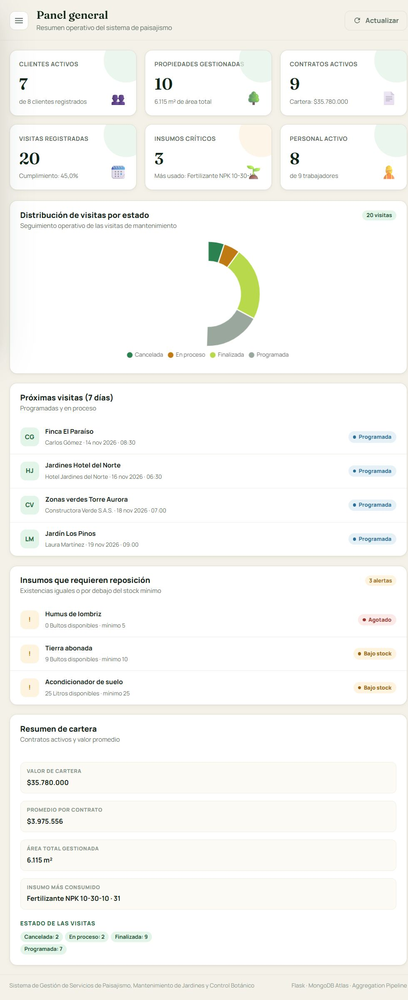

*Figura 3. Panel general con indicadores, próximas visitas, insumos críticos y gráficos.*

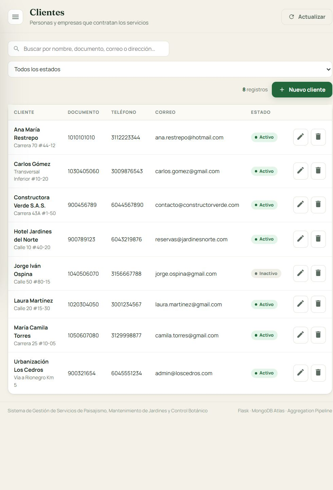

*Figura 4. Módulo de clientes con búsqueda, filtro por estado y acciones CRUD.*

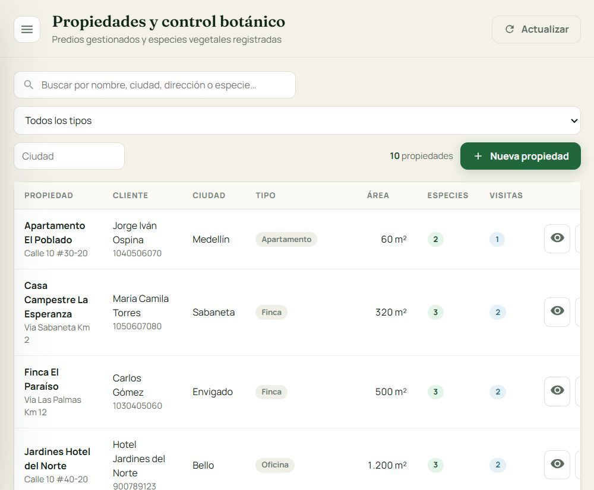

*Figura 5. Módulo de propiedades con cliente, ciudad, tipo, área, especies y visitas.*

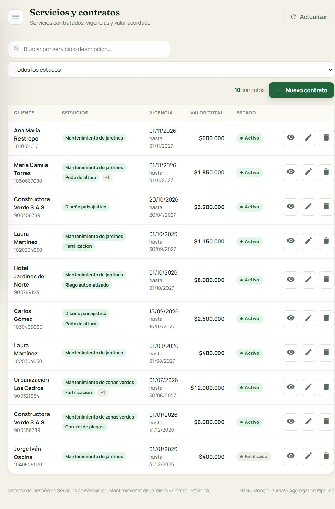

*Figura 6. Módulo de servicios y contratos con vigencia, valor y estado.*

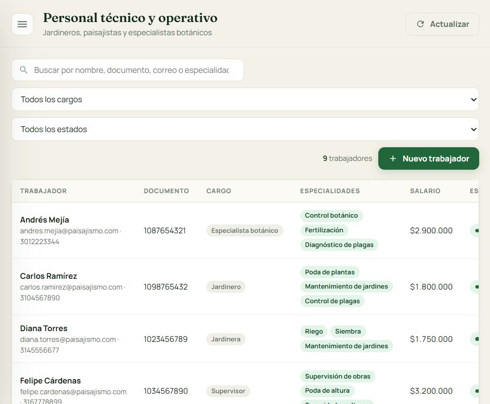

*Figura 7. Módulo de personal técnico y operativo con cargo y especialidades.*

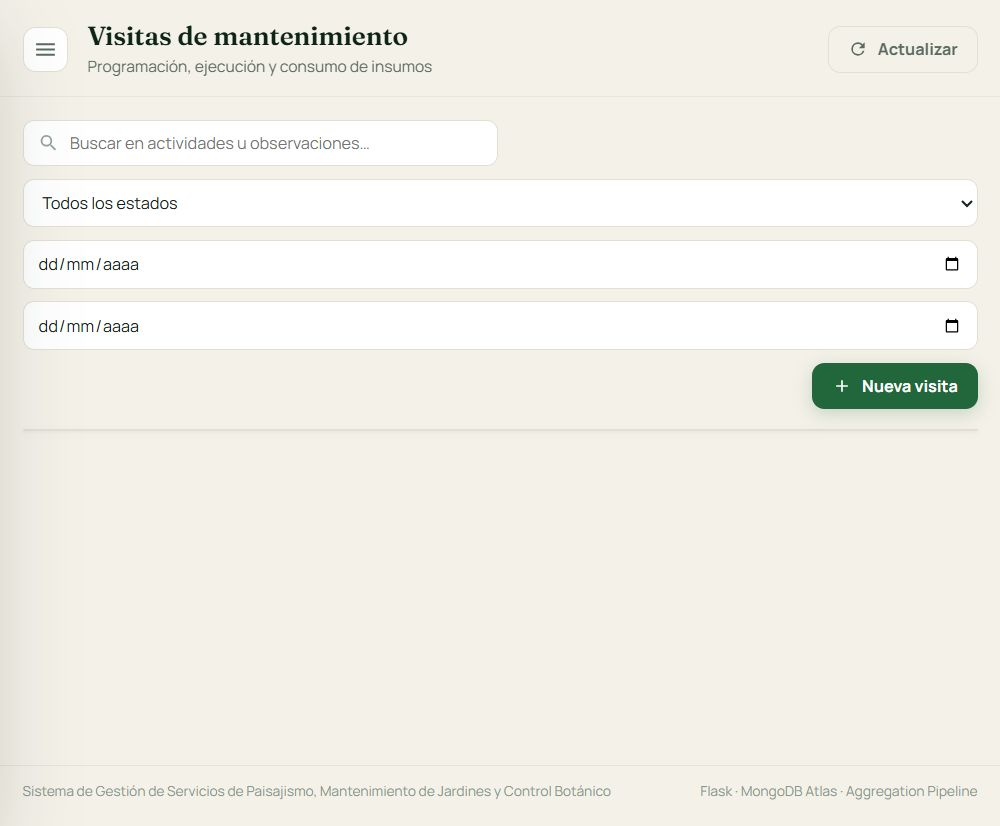

*Figura 8. Módulo de visitas de mantenimiento con propiedad, cliente, contrato, personal e insumos.*

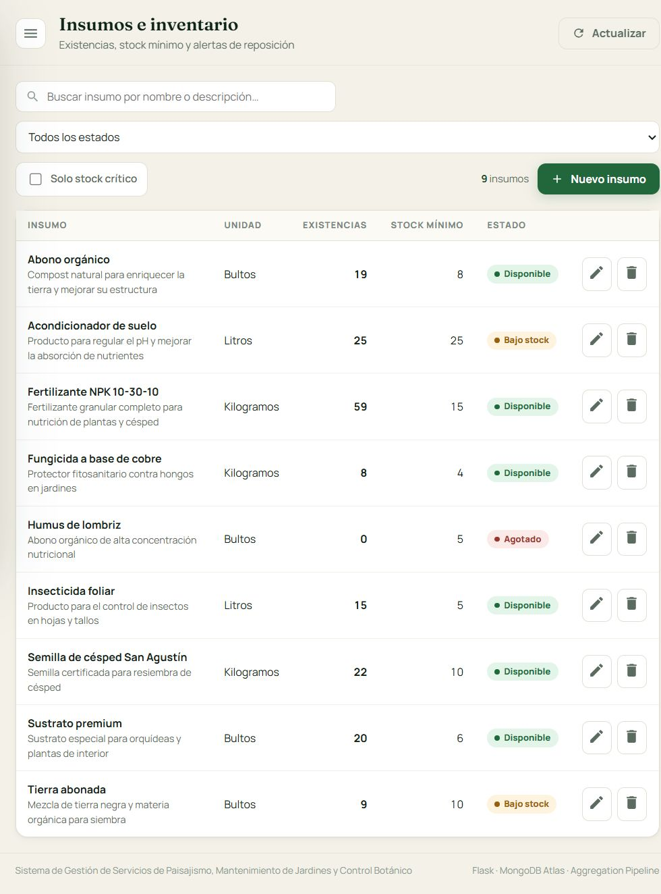

*Figura 9. Módulo de insumos con existencias, stock mínimo y estado.*

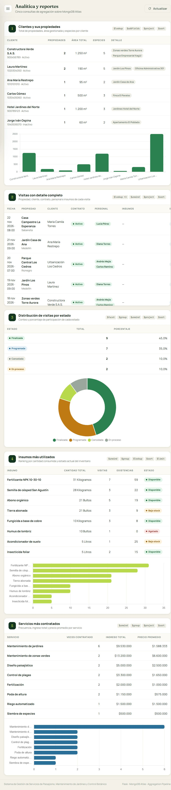

*Figura 10. Vista de analítica con los cinco reportes de agregación y sus gráficos.*

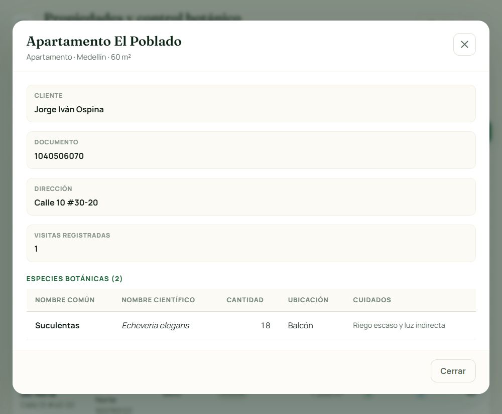

*Figura 11. Detalle de una propiedad con especies embebidas e historial de visitas.*

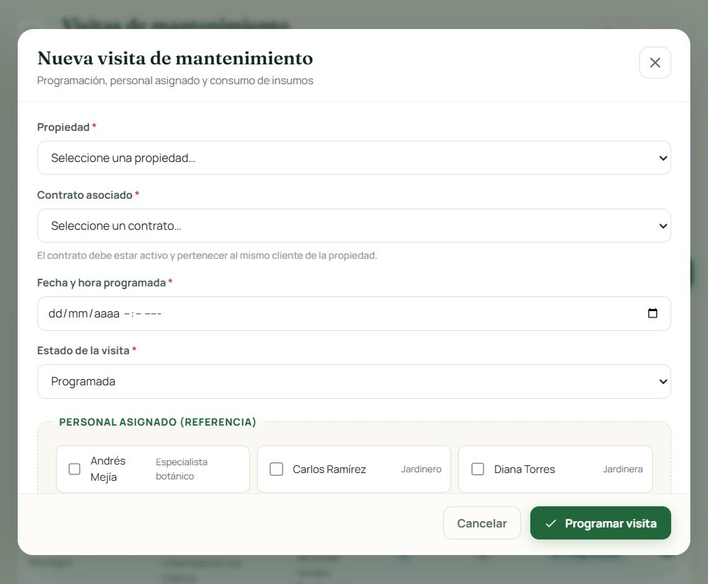

*Figura 12. Formulario de visita con selección de propiedad, contrato, personal e insumos.*

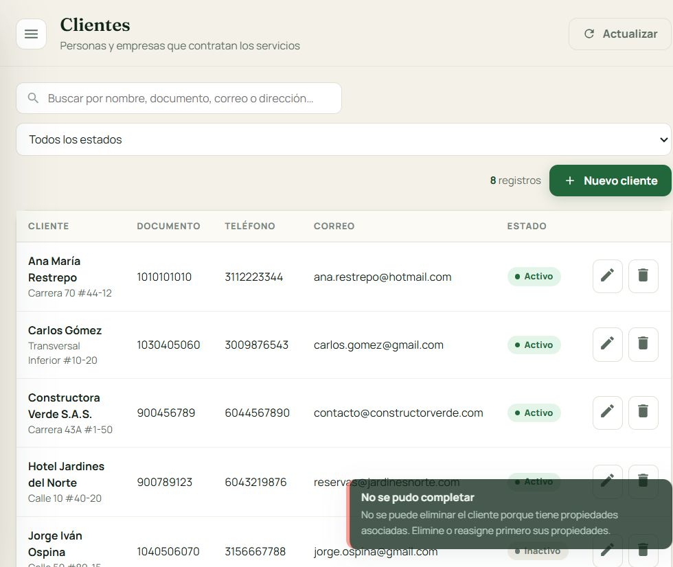

*Figura 13. Bloqueo de eliminación de un cliente con propiedades asociadas.*

## 12.2 Evidencias de la base de datos en la nube

Para completar la entrega, se deben anexar las capturas de MongoDB Atlas descritas en la sección 5.5. Mientras tanto, la conexión y la información almacenada se evidencian con las siguientes respuestas verificables de la API.

**Estado de la conexión y conteo de documentos:**

```json
{
  "estado": "ok",
  "base_de_datos": "jardineria_db",
  "colecciones": {
    "clientes": 8,
    "propiedades": 10,
    "servicios_contratos": 10,
    "personal": 9,
    "visitas_mantenimiento": 20,
    "insumos": 9
  }
}
```

**Ejemplo de documento almacenado en `clientes`:**

```json
{
  "_id": "6af68888aa65f37681fe74ca",
  "nombre": "Laura Martínez",
  "documento": "1020304050",
  "telefono": "3001234567",
  "correo": "laura.martinez@gmail.com",
  "direccion": "Calle 20 #15-30",
  "estado": "Activo"
}
```

**Ejemplo de documento almacenado en `propiedades` con especies embebidas:**

```json
{
  "_id": "6af68888aa65f37681fe74d1",
  "cliente_id": "6af68888aa65f37681fe74ca",
  "nombre": "Jardín Los Pinos",
  "direccion": "Carrera 45 #20-10",
  "ciudad": "Medellín",
  "tipo_propiedad": "Casa",
  "area_m2": 150,
  "especies": [
    {
      "nombre_comun": "Rosa",
      "nombre_cientifico": "Rosa spp.",
      "cantidad": 12,
      "ubicacion": "Jardín delantero",
      "necesidades_cuidado": "Riego frecuente, poda y abono cada 30 días"
    }
  ]
}
```

**Ejemplo de documento almacenado en `visitas_mantenimiento` con referencias y arreglos:**

```json
{
  "_id": "6af6888eaa65f37681fe74fb",
  "propiedad_id": "6af68888aa65f37681fe74d1",
  "contrato_id": "6af68888aa65f37681fe74d9",
  "fecha_programada": "2026-11-05T08:00:00Z",
  "personal_asignado": [
    { "personal_id": "6af6888baa65f37681fe74e6", "nombre": "Carlos Ramírez" },
    { "personal_id": "6af6888baa65f37681fe74e9", "nombre": "Diana Torres" }
  ],
  "actividades_realizadas": ["Poda de rosales", "Corte de césped", "Riego general"],
  "observaciones": ["El jardín se encuentra en buen estado general."],
  "estado": "Finalizada",
  "insumos_utilizados": [
    {
      "insumo_id": "6af6888caa65f37681fe74ef",
      "nombre": "Fertilizante NPK 10-30-10",
      "cantidad": 3,
      "unidad_medida": "Kilogramos"
    }
  ]
}
```

## 12.3 Evidencias del despliegue en internet

Una vez publicado el servicio en Render, se deben anexar:

- `16_render_servicio.jpg`: panel del servicio con estado **Live** y la URL pública.
- `17_render_variables.jpg`: variables de entorno configuradas, sin mostrar el valor de `MONGO_URI`.
- `18_render_logs.jpg`: logs de arranque con Gunicorn y conexión exitosa.
- `19_app_publica.jpg`: aplicación abierta desde la URL pública.
- `20_health_publico.jpg`: respuesta de `https://<servicio>.onrender.com/api/health`.

La sección 13 describe el procedimiento completo para generar estas evidencias.

## 12.4 Índice de evidencias

| Archivo | Contenido | Estado |
|---|---|---|
| `01_panel_general.jpg` | Panel general | Incluida |
| `02_clientes.jpg` | Módulo de clientes | Incluida |
| `03_propiedades.jpg` | Módulo de propiedades | Incluida |
| `04_contratos.jpg` | Módulo de contratos | Incluida |
| `05_personal.jpg` | Módulo de personal | Incluida |
| `06_visitas.jpg` | Módulo de visitas | Incluida |
| `07_insumos.jpg` | Módulo de insumos | Incluida |
| `08_analitica.jpg` | Vista de analítica | Incluida |
| `09_detalle_propiedad.jpg` | Detalle de propiedad | Incluida |
| `10_formulario_visita.jpg` | Formulario de visita | Incluida |
| `11_regla_eliminacion.jpg` | Regla de eliminación | Incluida |
| `12_atlas_colecciones.jpg` | Colecciones en Atlas | Pendiente de anexar |
| `13_atlas_documentos.jpg` | Documentos e integridad en Atlas | Pendiente de anexar |
| `14_atlas_agregaciones.jpg` | Aggregations en Atlas | Pendiente de anexar |
| `15_atlas_indices.jpg` | Índices en Atlas | Pendiente de anexar |
| `16_render_servicio.jpg` | Servicio en Render | Pendiente de anexar |
| `17_render_variables.jpg` | Variables de entorno en Render | Pendiente de anexar |
| `18_render_logs.jpg` | Logs de despliegue | Pendiente de anexar |
| `19_app_publica.jpg` | Aplicación pública | Pendiente de anexar |
| `20_health_publico.jpg` | Health check público | Pendiente de anexar |

# 13. Despliegue

## 13.1 Ejecución local

**Requisitos:** Python 3.11 o superior y una base de datos MongoDB Atlas.

```bash
# 1. Clonar el repositorio
git clone https://github.com/dannagarciaji-svg/Sistema_Paisajismo.git
cd Sistema_Paisajismo

# 2. Crear y activar el entorno virtual
python -m venv venv
venv\Scripts\activate        # Windows
source venv/bin/activate     # Linux/macOS

# 3. Instalar dependencias
pip install -r requirements-dev.txt

# 4. Configurar credenciales
copy .env.example .env       # Windows
cp .env.example .env         # Linux/macOS
# Editar .env con MONGO_URI y MONGO_DB

# 5. Cargar datos de demostración
python seed.py

# 6. Ejecutar la aplicación
flask --app app run --port 5000
```

Abrir `http://127.0.0.1:5000`.

## 13.2 Despliegue en Render

El proyecto incluye `render.yaml` y `Procfile` para facilitar el despliegue:

```yaml
services:
  - type: web
    name: verdevivo-paisajismo
    runtime: python
    plan: free
    region: oregon
    buildCommand: pip install -r requirements.txt
    startCommand: gunicorn app:app --bind 0.0.0.0:$PORT --workers 2 --threads 4 --timeout 120
    healthCheckPath: /api/health
    autoDeploy: true
    envVars:
      - key: MONGO_URI
        sync: false
      - key: MONGO_DB
        value: jardineria_db
```

**Pasos:**

1. Subir el proyecto a un repositorio público de GitHub sin el archivo `.env`.
2. En Render, seleccionar **New Web Service** y conectar el repositorio.
3. Verificar que Render detecte `render.yaml` o configurar manualmente:
   - **Build Command:** `pip install -r requirements.txt`
   - **Start Command:** `gunicorn app:app --bind 0.0.0.0:$PORT --workers 2 --threads 4 --timeout 120`
4. En **Environment Variables**, agregar `MONGO_URI` con la cadena de Atlas y `MONGO_DB` con `jardineria_db`.
5. En MongoDB Atlas, habilitar el acceso de red necesario para Render.
6. Desplegar y verificar `https://<servicio>.onrender.com/api/health`.
7. Abrir la URL pública y recorrer las vistas para confirmar el funcionamiento.

## 13.3 Variables de entorno en producción

| Variable | Configuración | Observación |
|---|---|---|
| `MONGO_URI` | Secreto de Render | No se muestra en el repositorio ni en la documentación |
| `MONGO_DB` | `jardineria_db` | Valor público, no sensible |

## 13.4 Acceso de red en MongoDB Atlas

En **Network Access**, agregar la dirección IP del equipo de desarrollo y el rango de salida de Render. Para una demostración académica se puede habilitar temporalmente `0.0.0.0/0`, con la recomendación de restringirlo después. Verificar que el usuario de base de datos tenga permisos de lectura y escritura sobre `jardineria_db`.

## 13.5 Verificación posterior al despliegue

- `GET /api/health` devuelve `200` y `estado: ok`.
- La SPA carga desde la raíz `/`.
- Los listados muestran datos reales de Atlas.
- Se puede crear, editar y eliminar un registro de prueba.
- Los cinco reportes de analítica responden.
- El panel muestra los indicadores actualizados.
- Las credenciales no aparecen en el código ni en el repositorio.

## 13.6 Evidencias de despliegue

Las capturas deben tomarse después de publicar el servicio y anexarse con los nombres indicados en la sección 12.3. La URL pública debe registrarse en la portada, en el README y en el anexo de enlaces.

## 13.7 Recomendaciones operativas

- Rotar la contraseña de Atlas si se comparte el proyecto fuera del entorno académico.
- Restringir la lista de acceso de red al rango de Render en producción.
- Configurar copias de seguridad y alertas de consumo en Atlas.
- Revisar los logs de Render ante errores `500` o `503`.
- Ejecutar `python seed.py` solo en entornos de demostración, porque reinicia las colecciones.
- Mantener `requirements.txt` con versiones fijas para reproducibilidad.

# 14. Conclusiones

## 14.1 Conclusiones del desarrollo

1. **Pertinencia del modelo híbrido NoSQL.** La combinación de Embedding (especies, servicios, especialidades, actividades y observaciones) y Referencing mediante ObjectId (clientes, propiedades, contratos, personal e insumos) demostró ser una estrategia adecuada. Permite leer la ficha completa de una propiedad o un contrato en una sola consulta, sin duplicar entidades maestras que se actualizan con frecuencia.

2. **Importancia de la validación en el backend.** La flexibilidad de esquema de MongoDB no exime de controles. La capa lógica en Flask fue indispensable para garantizar unicidad de documentos, formatos de fecha ISO, existencia de referencias, coherencia entre propiedad y contrato, vigencia de contratos y disponibilidad de inventario.

3. **Escalabilidad mediante arquitectura modular.** La separación en Blueprints y la centralización de la conexión en `backend/config.py` mejoraron la legibilidad, el mantenimiento y la separación de responsabilidades. Cada módulo puede evolucionar sin afectar a los demás.

4. **Valor estratégico de los Aggregation Pipelines.** `$lookup`, `$unwind`, `$group`, `$sort`, `$limit` y `$project` transformaron los datos operativos en indicadores accionables: cumplimiento de visitas, servicios más demandados, consumo real de insumos y clientes con mayor área gestionada.

5. **Control de inventario confiable.** El uso de operaciones atómicas y mecanismos de compensación evitó inconsistencias entre las visitas y las existencias. El estado del insumo se deriva de los datos y no se recibe del usuario, lo que reduce errores.

6. **Buenas prácticas de seguridad en la nube.** La gestión de variables de entorno, la exclusión de `.env` en `.gitignore`, el uso de TLS y la configuración de usuarios y redes en Atlas consolidaron un entorno seguro para una aplicación conectada a la nube.

7. **Documentación como parte del producto.** La documentación técnica, los diagramas reproducibles, las capturas y las pruebas automatizadas permiten que una persona externa comprenda el problema, la arquitectura, el modelo, las reglas y la forma de operar la solución.

## 14.2 Aprendizajes obtenidos

- El modelado documental exige analizar los patrones de acceso antes de decidir entre embeber y referenciar.
- La integridad referencial en MongoDB debe implementarse explícitamente en la capa de aplicación.
- Las operaciones atómicas son esenciales cuando varios usuarios o procesos pueden modificar inventario al mismo tiempo.
- Un frontend sin compilación puede ofrecer una experiencia completa si se organiza correctamente y se apoya en una API clara.
- Las pruebas de integración detectan regresiones que las pruebas manuales no siempre evidencian.
- La seguridad de las credenciales debe diseñarse desde el inicio, no como un ajuste posterior.

## 14.3 Limitaciones

- No hay autenticación ni roles de usuario; el acceso se controla en el entorno de despliegue.
- No se usan transacciones multi-documento; se aplican validaciones y compensaciones.
- El clúster gratuito tiene límites de almacenamiento y conexiones.
- La aplicación no incluye facturación, pagos ni integración contable.
- Las capturas de Atlas y Render deben ser anexadas por la autora después de publicar el servicio.

## 14.4 Trabajo futuro

- Incorporar autenticación con roles (administrador, supervisor, jardinero).
- Agregar carga de fotografías de las propiedades y de las especies.
- Implementar notificaciones automáticas de visitas próximas y stock crítico.
- Añadir reportes exportables a PDF y Excel.
- Integrar un calendario de programación y recordatorios.
- Incorporar geolocalización y rutas de visita.
- Evaluar el uso de transacciones multi-documento en un clúster con soporte de replica set.
- Agregar pruebas unitarias y de interfaz automatizadas.

# 15. Anexos

## 15.1 Enlaces de entrega

| Elemento | Enlace |
|---|---|
| Repositorio Git | `https://github.com/dannagarciaji-svg/Sistema_Paisajismo` |
| Aplicación desplegada | `[PENDIENTE: URL pública de Render]` |
| Documentación técnica | `docs/Documentacion_Tecnica_Sistema_Paisajismo.md` |
| Documento DOCX | `docs/Documentacion_Tecnica_Sistema_Paisajismo.docx` |
| Evidencias | `docs/evidencias/` |
| Diagramas | `docs/diagramas/` |

## 15.2 Datos de demostración

| Colección | Documentos | Observaciones |
|---|---|---|
| `clientes` | 8 | 7 activos y 1 inactivo |
| `propiedades` | 10 | Casas, fincas, apartamentos, oficinas, conjunto residencial y parque |
| `servicios_contratos` | 10 | 9 activos y 1 finalizado |
| `personal` | 9 | 8 activos y 1 inactivo |
| `visitas_mantenimiento` | 20 | 9 finalizadas, 7 programadas, 2 en proceso y 2 canceladas |
| `insumos` | 9 | 3 en nivel crítico: 1 agotado y 2 en bajo stock |

## 15.3 Comandos útiles

```bash
# Instalar dependencias de producción
pip install -r requirements.txt

# Instalar dependencias de desarrollo y pruebas
pip install -r requirements-dev.txt

# Cargar o restaurar los datos de demostración
python seed.py

# Ejecutar el servidor local
flask --app app run --port 5000

# Ejecutar el servidor en un puerto alterno
flask --app app run --port 5010 --no-reload

# Ejecutar las pruebas de integración
python pruebas/smoke_test.py http://127.0.0.1:5010

# Regenerar los diagramas
python docs/generar_diagramas.py

# Generar el documento DOCX
python docs/generar_docx.py
```

## 15.4 Estructura de la base de datos

```text
jardineria_db
├── clientes
├── propiedades
├── servicios_contratos
├── personal
├── visitas_mantenimiento
└── insumos
```

## 15.5 Variables de entorno

```text
MONGO_URI=mongodb+srv://<usuario>:<contraseña>@<cluster>.mongodb.net/?retryWrites=true&w=majority
MONGO_DB=jardineria_db
```

## 15.6 Lista de verificación de la entrega

- [x] Base de datos en MongoDB Atlas con seis colecciones.
- [x] Modelo documental con Embedding y Referencing justificados.
- [x] Backend Flask modular con Blueprints.
- [x] CRUD completo de las seis entidades.
- [x] Búsqueda y filtros en todos los módulos.
- [x] Relaciones legibles mediante `$lookup`.
- [x] Reglas de negocio y validaciones en backend.
- [x] Control automático de inventario.
- [x] Cinco consultas analíticas con Aggregation Pipeline.
- [x] Panel general con KPIs y gráficos.
- [x] Interfaz web responsive en español.
- [x] 28 pruebas de integración aprobadas.
- [x] Diagramas de arquitectura y modelo de datos.
- [x] Evidencias de la aplicación.
- [x] Documentación técnica en Markdown y DOCX.
- [x] Archivos de despliegue (`Procfile`, `render.yaml`, `requirements.txt`).
- [x] Credenciales protegidas con `.env` y `.gitignore`.
- [ ] Repositorio público en GitHub con la URL registrada.
- [ ] Servicio publicado en Render con la URL registrada.
- [ ] Capturas de MongoDB Atlas anexadas.
- [ ] Capturas del despliegue en Render anexadas.

## 15.7 Referencias

- MongoDB. (2026). *MongoDB Manual: Aggregation Pipeline*. https://www.mongodb.com/docs/manual/core/aggregation-pipeline/
- MongoDB. (2026). *MongoDB Atlas Documentation*. https://www.mongodb.com/docs/atlas/
- MongoDB. (2026). *Data Modeling: Embedding vs. Referencing*. https://www.mongodb.com/docs/manual/data-modeling/
- Pallets Projects. (2026). *Flask Documentation*. https://flask.palletsprojects.com/
- PyMongo. (2026). *PyMongo Documentation*. https://pymongo.readthedocs.io/
- Render. (2026). *Deploy a Flask App*. https://render.com/docs/deploy-flask
- W3C. (2026). *HTML Living Standard*. https://html.spec.whatwg.org/
- Chart.js. (2026). *Chart.js Documentation*. https://www.chartjs.org/docs/

---

*Documento generado como parte del proyecto final de Bases de Datos II. Las capturas de MongoDB Atlas y del despliegue en Render deben anexarse después de publicar la solución, de acuerdo con la lista de verificación del anexo 15.6.*
